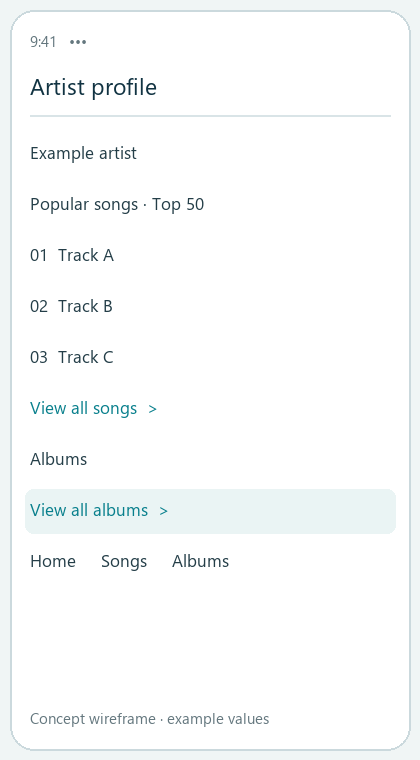
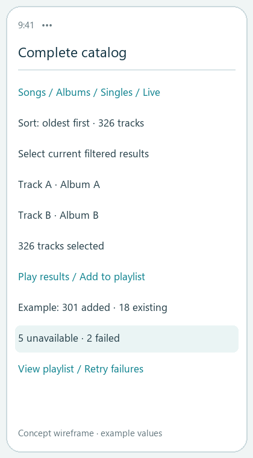
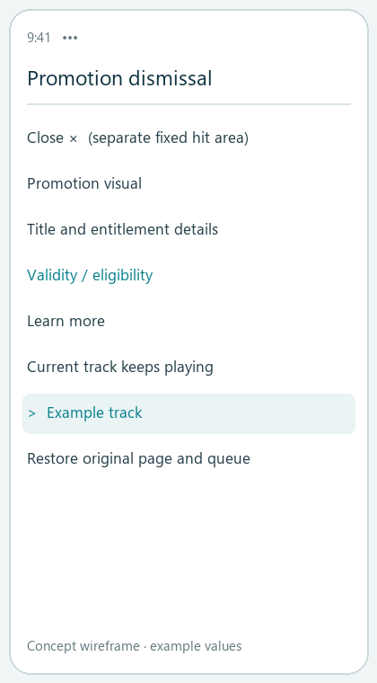
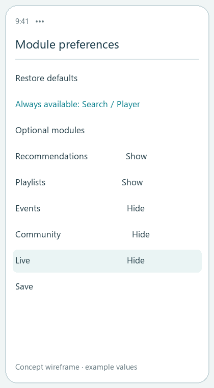
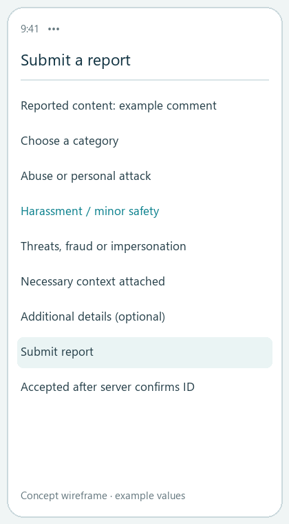
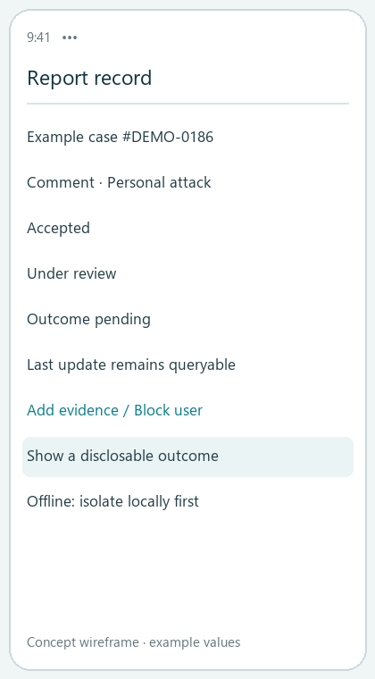

# NetEase Cloud Music

User research → scoped product requirements | Aug–Sep 2026

A mobile-product study connecting survey evidence, public feedback, QQ Music and Spotify comparisons to three proposals for music discovery, uninterrupted listening, and report-status transparency.

159 responses collected | 110 retained responses | 30 public feedback items | 12 requirement groups

## My work

Survey design and synthesis, issue classification and association analysis, requirement scoring, competitive comparison, and a three-feature PRD.

## Delivery status

Research and requirements are complete. Screens are conceptual wireframes. Current-version checks, technical review, usability validation and rollout remain future work; metrics describe a validation plan.

## Sample boundaries

19 survey questions. Ages 18–30: 101 (91.8%); students: 83 (75.5%); men: 79. Recruitment used personal networks and forwarding. Findings describe this sample.

## How evidence is used

Survey results estimate reach and segment differences. Thirty public feedback items provide task-level context. Associations inform hypotheses with explicit limits on causal interpretation.

---

# Separate friction from behavioral consequences

Findings from the 110 retained responses

| Evidence | Sample finding | Product implication |
| --- | --- | --- |
| Search usage | 109 of 110 respondents | Protect the path from discovery to playback |
| Promotion friction | 51 (46.4%); 2.50 / 5 rating | Unify timing, frequency, dismissal and task recovery |
| Navigation friction | 37 (33.6%); usability 2.95 / 5 | Prioritize stable core entry points and configurable modules |
| Catalog problems | 25; 23 reported behavior/payment changes | Distinguish licensing dependencies from interface scope |
| Lapsed membership | 30 of 32 used competing apps | Evaluate renewal value as a separate segment |
| Repeated recommendations | 24 of 64 recommendation users | Preserve matching strengths; improve exploration and control |

## Analysis method

3,000 permutation tests for associations; Cramer’s V for categorical relationships and epsilon-squared for score/intention differences. Benjamini–Hochberg FDR correction covered 34 tests.

## Interpretation limits

Advertising was frequent and poorly rated, but its association with reported behavioral change did not remain significant after FDR adjustment. Repetition complaints came from active recommendation users; exposure affects the pattern.

## Preserve existing strengths

Positive feedback highlighted preference matching, synchronized lyrics, stable playback, and comment stories. Proposed improvements target specific gaps within user tasks.

---

# From 12 requirement groups to three proposals

Keep the original scoring record and final PRD scope distinct

| Final proposal | Requirement lineage | Scope decision |
| --- | --- | --- |
| Complete artist catalog browsing | R07 | P1; accessible entries, filters, sort order and explicit batch scope |
| Promotion control and module management | R02 / R03 | P1; current-version and membership checks precede development |
| Report progress and interaction safety | R09 / R10 | P0; prioritize a traceable safety and trust workflow |

## Prioritization framework

Reach, task impact, behavioral impact and evidence strength each receive 1–3 points. Core-task blockers and safety issues qualify for P0. R01 has A/B subrequirements: 12 groups and 13 scored entries.

## Scope revision

Early drafts explored licensing explanations, cloud-library batch tools and cross-device synchronization. Rechecking existing capabilities and concrete feedback removed complex mechanisms with weak evidence or heavy dependencies from the final scope. Original scores remain decision history.

## Competitive lenses

QQ Music is the domestic direct competitor for retrieval, content and memberships. Spotify is the product-model reference for library organization, recommendation control and cross-device tasks. Observations retain the August 20, 2026 research cutoff.

## Turn comparisons into decisions

Evaluate whether users can identify operation scope, resume listening, and track report handling. List licensing supply, synchronization and commercial revenue as dependencies with validation gates.

---

# Find the catalog. Confirm the operation scope.

P1 | Complete artist catalog browsing and organization

## Main path

Artist page → all songs/albums → filter by type and release date → play current results or add them to a playlist → review outcome details.

## Business rules

Label the popular section “Top 50” and expose the complete catalog. Unknown metadata goes to “Other.” Deduplicate batch additions and report added, existing, unavailable and failed items separately.

## Recovery behavior

Pagination and background tasks keep large catalogs usable. Preserve filters and scroll position when returning. Retry failed items only, using idempotency to avoid duplicate successful writes.

## Acceptance and measures

Check entry visibility, filtering, playback scope and batch outcomes. Track full-catalog entry reach, task completion, batch success and failed-item recovery.

---

# Dismiss the promotion. Resume the task.

P1 | Current-release checks are a prerequisite

## Display decision

Check task context, playback, session/day limits, recent dismissal, membership entitlement and creative validity. Defer ordinary promotions or use a non-blocking area when interruption is inappropriate.

## Dismissal and frequency

After dismissal, the same promotion stays suppressed for the session. A session ends after more than 30 minutes in the background. Separate dismissal from navigation; the PRD specifies a fixed hit area of at least 44 × 44 pt.

## Modules and entitlements

Keep search, playback, safety and account entries accessible. Optional modules can be hidden, reordered and reset. Entitlement failures use a low-interruption fallback; safety notices use separate rules.

## Validation and measures

Retest signed-out, free, VIP and SVIP accounts across launch/return/track-change scenarios and network conditions. Compare repeat exposure, task recovery, accidental navigation and commercial conversion together.

---

# Make report handling visible and traceable.

P0 | Comment and stranger-interaction safety

## Routing and state

Violations go to reporting; unrelated content goes to quality feedback; personal dislikes go to preference controls. Show “Accepted” only after the server returns a case ID, followed by review, additional-information requests and an outcome.

## Immediate protection

Exit and local blocking take effect first. During network failure, isolate locally and sync later. Blocking is personal contact control. Moderation uses evidence and rules; report volume supports triage.

## Privacy and failures

Keep unsuccessful submissions as drafts. Repeated submissions open the existing case with an option to add evidence. Disclose necessary outcome categories; the record center remains available when notifications fail.

## Acceptance and measures

Check IDs, consistent states, evidence supplementation, queryable outcomes and offline isolation. Measure acceptance success/latency, handling time, outcome visibility and post-block contact failures.

---

# Validation plan and delivery evidence

Define reviewable next steps

| Stage | Checks | Decision gate |
| --- | --- | --- |
| Baseline | Current-release verification and 14-day measures | Remove resolved or unreproducible issues |
| Limited rollout | Release in stages with rollback switches | Evaluate task experience, performance, revenue and safety |
| Evaluation | Success rates, failures, handling times and guardrails | Set targets from baseline; pause expansion on serious failures |

## Artifacts

Research synthesis; needs analysis and priority matrix; QQ Music/Spotify comparison; full Chinese PRD; bilingual case studies and six concept wireframes with task flows and business rules.

## Traceability

Scenario → flow → prototype → event → acceptance criterion. Section 16 of the full PRD contains the mapping; this case explains the three task chains separately.

## Implementation dependencies

Content metadata and playlist services, client/ad SDK behavior, membership entitlements, moderation-state APIs, customer operations and analytics. Each dependency has a failure-handling rule.

## Project context

An independent product-research project studying the NetEase Cloud Music mobile app. Deliverables include user research, prioritization, competitive analysis, product requirements and concept wireframes.

## Project repository

https://github.com/Ginga2003/netease-cloud-music-product-case

---
