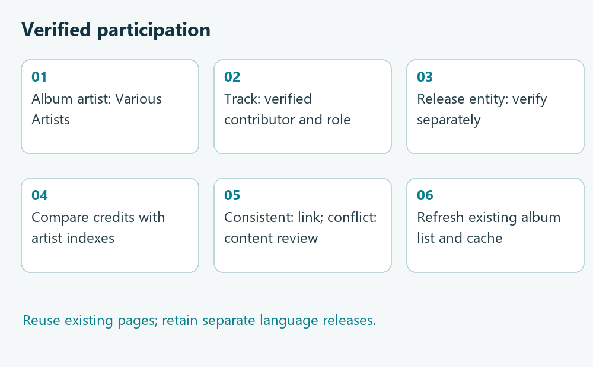
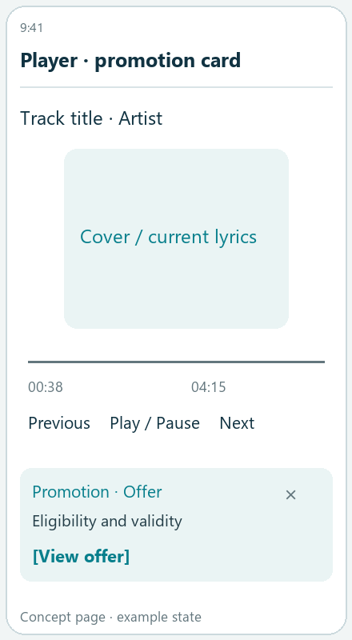
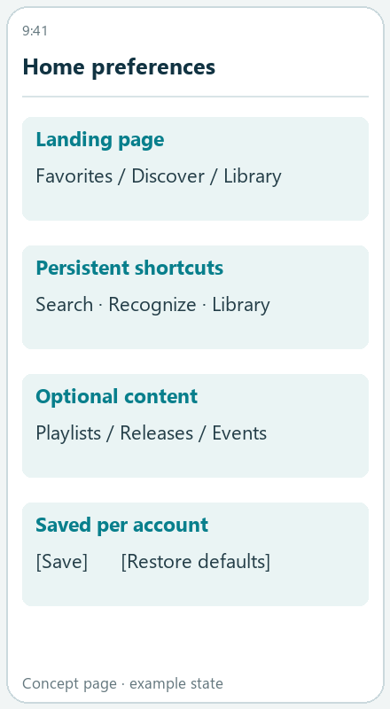
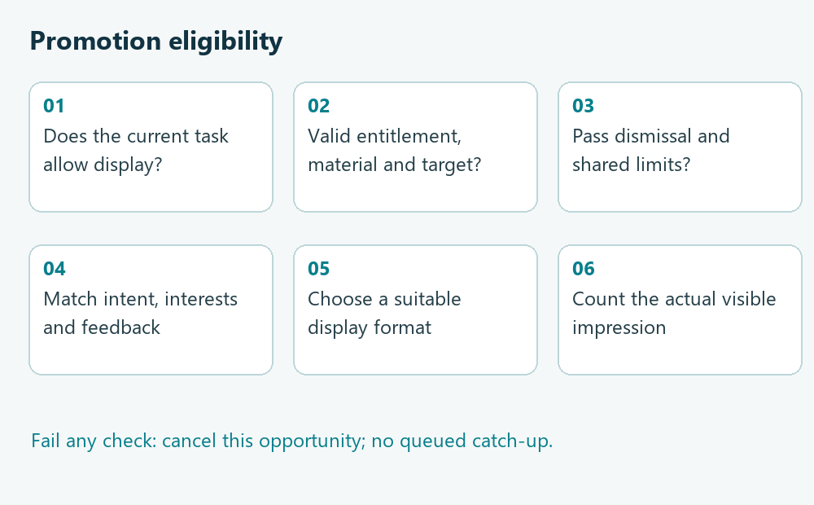
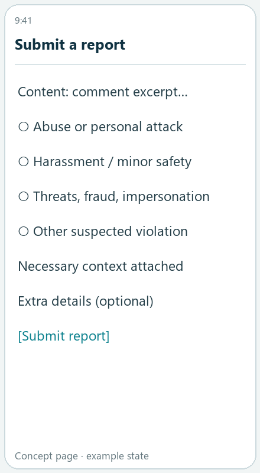
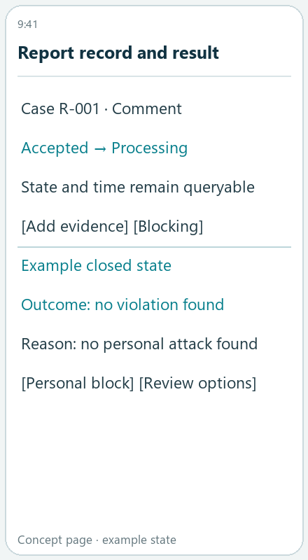

# NetEase Cloud Music

Personal course project | User research and product requirements

A mobile-product study covering music discovery, listening and community interactions. Survey synthesis, requirement analysis and competitor mechanisms inform three proposals, with business rules, interaction flows, metrics and acceptance criteria in a PRD.

159 responses collected | 110 retained responses | 30 public feedback items | 12 requirement groups

## My contribution

Designed and analyzed the survey, grouped problems into needs, checked existing capabilities through hands-on use and screenshots, compared competitor mechanisms, and wrote the PRD.

## Research-to-design chain

Survey and public feedback → seven issue categories → twelve requirement groups, including two R01 subitems → scenario checks and scope selection → competitor mechanisms → proposals and acceptance criteria.

## Three proposal directions

Complete artist catalog browsing and organization; promotion interruption control; transparent report handling for comments and stranger interactions. Promotion control is the main experience proposal, supported by catalog relations and safety feedback.

## Delivery status

The research report, requirement analysis, competitive analysis and PRD are complete, including flows, concept pages, rules and validation plans. Business impact requires future testing and rollout.

---

# From problem signals to a feasible scope

Survey findings guide attention; concrete tasks define the gap

| Observation | Sample finding | Design input |
| --- | --- | --- |
| Ads, pop-ups or activity prompts | 51/110, 46.4%; rating 2.50/5 | Check timing, occupied areas and repeated exposure |
| Information or entry-point friction | 37/110, 33.6% | Check first-screen discovery and key task paths |
| Main functions used | Search 109; personal music 72; recommendations 64 | Support intentional search alongside discovery |
| Comments and community | Six mentions among 65 substantive open responses | Check exit, reporting and follow-up in concrete cases |

## Turning feedback into needs

Describe the user goal, the task step, the obstacle and the required outcome. A promotion covering track information creates a need to keep that information and its controls accessible.

## Selection criteria

Consider problem severity, evidence strength, reach and implementation dependencies. Promotion has survey support and task records; reporting supports safety and follow-up; catalog relations have a specific omission and an existing repair path.

## Priority and scope

Report feedback is the P0 foundation. Promotion control and catalog relations are P1. Licensing procurement and complex synchronization remain in the wider pool. Lineage: R07; R02/R03 and relevant R08 items; relevant R09/R10 items.

## Evidence limits

Eight responses failed hard quality checks; another 41 were excluded in further screening. The sample is concentrated among young students. Public feedback is qualitative. Retention and revenue effects require subsequent experiments.

---

# Turn competitor mechanisms into design rules

QQ Music and Spotify; targeted references from TuneCore and YouTube

| Topic | Reference mechanism | PRD decision |
| --- | --- | --- |
| Catalog relations | Spotify compilations / Appears On; TuneCore participating works | Retain Various Artists; add verified artist participation |
| Promotion control | QQ Music personalization; Spotify preferences and ad-set caps | Separate matching, dismissal and frequency; protect key tasks |
| Report feedback | Spotify reporting / interaction controls; YouTube report history | Persistent records, distinct states, explained outcomes and next actions |

## Catalog organization

Compilation credit can coexist with discovery through a participating artist. Verify distributor, album-artist and track-participant roles separately; state the relevant tracks for partial participation.

## Promotion trade-offs

Relevance and exposure frequency need separate controls. Spotify ad-set caps apply within that advertising scope. This proposal adds shared limits across pages and interrupting promotion types. Basic display rules also apply when personalization is off.

## Report-state clarity

YouTube Live can mean awaiting review or no violation found, with limits to history coverage. The proposal separates accepted, processing and closed states, explains outcomes, and preserves personal blocking and applicable review options.

## Evidence scope

References use official help, privacy guidance and ad specifications checked on November 1, 2026. Availability varies by region, release and entitlement. Mobile task testing remains part of the validation plan; full references are in the competitive report.

---

# Make participating releases discoverable

Complete artist catalog browsing | P1 supporting proposal

## Observed case

The Japanese MementoMori Lament Collection Vol.4 can be searched independently and credits Various Artists. The BOI album list includes the English release, while the Japanese release is missing from that path. Track credits and release records support relation checks.

## Design scope

Retain the compilation credit. Distinguish track contributors, album artists and releasing entities. Add verified artist–album relations to existing pages and lists. Keep independently released language versions separate.

## Verification and repair

Compare track credits, album metadata and artist indexes to identify missing relations. Apply consistent role/range matches; send conflicting differences to content review. Refresh indexes and caches, retain the basis for changes and support reversal of incorrect links.

## Acceptance and measures

Use compilations with verified participation. Check relation coverage, incorrect links, partial participation and language versions, then measure success and steps for finding a specified release from the artist page.

---

# Protect listening tasks and match promotions

Promotion interruption control | P1 main experience proposal

## User path and observed impact

Open → search or recognize → play → view information/comments → return. Audio continued during the recorded promotion, while a large card occupied the music display area. Foreground-return ads and cross-page prompts added dismissal and recovery effort.

## Timing, placement and intentional actions

Protect search, recognition, track controls, payment, reporting and player restoration. Place eligible cards outside track information and controls. Separate dismissal from navigation. Normal refresh, browsing and device movement retain their expected functions.

## Personalization and access

After entitlement and display checks, rank eligible content using intentional behavior, explicit interests and feedback. Keep search, recognition and personal music discoverable. Respect the user’s chosen landing page and optional-module order.

---

# Shared limits, feedback and evaluation

Measure task outcomes, acceptance and commercial impact together

## Eligibility sequence

Current task → entitlement/material validity → dismissal and shared limits → matching → suitable format → actual impression. Cancel ineligible or missed opportunities; do not queue them for later display.

## Dismissal and preferences

Closing an activity suppresses passive exposure across pages and creatives for that session. Not interested applies across sessions until the activity ends or the user restores it. Reduce similar content lowers frequency and rank. Interrupting ads, offers, activities and automatic guides share a budget.

## Recovery and entitlements

Restore the current page, track, queue and latest playback intent on return. Explain member-track restrictions separately from free-time limits. Before a voluntary rewarded ad, explain its conditions, reward and external navigation; recheck entitlements on return.

## Evaluation

Count failures and abandonment in assigned tasks; include ad and loading time. Assess mistaken navigation, dismissal, negative feedback, valid conversion and revenue per use. Dwell time is supplementary. Use concurrent controls and staged rollout, with targets informed by the baseline.

---

# Traceable reports and explained outcomes

Comments and stranger interactions | P0 foundation

## Immediate control and acceptance

Let users exit and choose local hiding or blocking, then decide whether to report. Create a case ID and queryable record after server acceptance. Preserve drafts on failure; check acceptance after a timeout to avoid duplicate submissions.

## Progress and persistent records

Accepted means waiting; processing starts when review actually begins. Requests for more evidence state requirements and a deadline. Notifications link to the same record, which remains accessible if delivery fails. Explain delays in both waiting and processing stages and escalate internally.

## All closure types and next actions

Explain outcomes and timestamps for action taken, no violation found, insufficient evidence and other closures. A no-violation result can explain that no personal attack was found. Keep personal hiding/blocking and applicable evidence or review options available.

---

# Delivery and validation

A connected evidence chain with testable requirements

| Deliverable | Contents | Role in the chain |
| --- | --- | --- |
| Research report | Survey aggregates, public feedback, task cases and evidence limits | Identify problem themes and preserve provenance |
| Requirement analysis | Seven categories, twelve groups, user tasks and dependencies | Explain selection of the three proposal directions |
| Competitive analysis | Catalog relations, promotion controls and reporting mechanisms | Translate relevant mechanisms into design inputs |
| PRD | Rules, flows, states, exceptions, metrics and acceptance criteria | Define technical review and test scope |

## Validation plan

Establish baselines by entitlement, landing mode, entry point and network condition; run prototype tasks and technical review. Compare promotion task costs and commercial outcomes using concurrent controls. Test relation accuracy and report-record completeness separately.

## Acceptance focus

Catalog: verified participation is discoverable with accurate credits. Promotion: tasks, information and entry points remain usable and rejection rules apply. Reporting: accepted cases remain queryable and every closure has an explanation; local blocking works independently.

## Outcome claims

Current outputs are research and requirements artifacts. Survey findings, public feedback and task records support problem identification. Retention, conversion and revenue benefits remain hypotheses for validation. Public data is aggregated.

## Reference entry points

Spotify compilation, ad-preference and safety documentation; QQ Music privacy guidance; TuneCore Japan BOI participating works; YouTube reporting history. The competitive report contains source links and verification dates.

---
