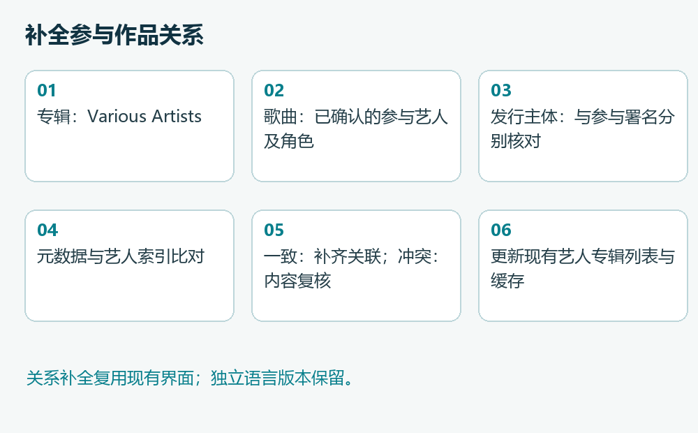
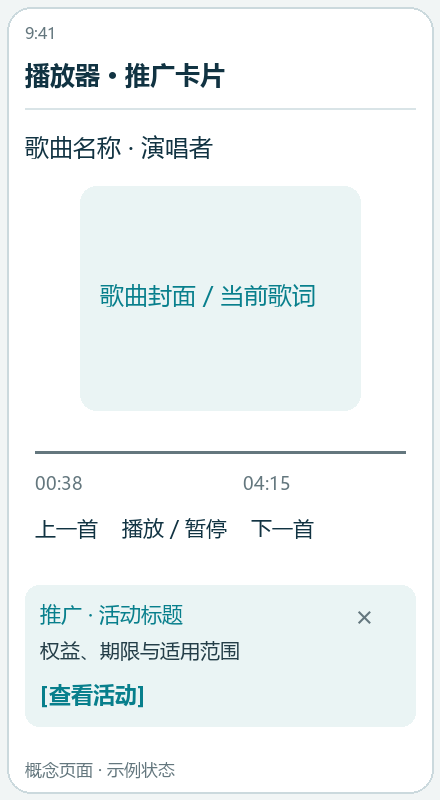
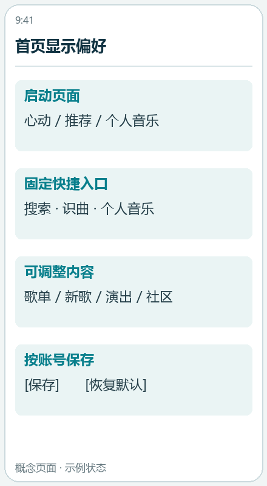
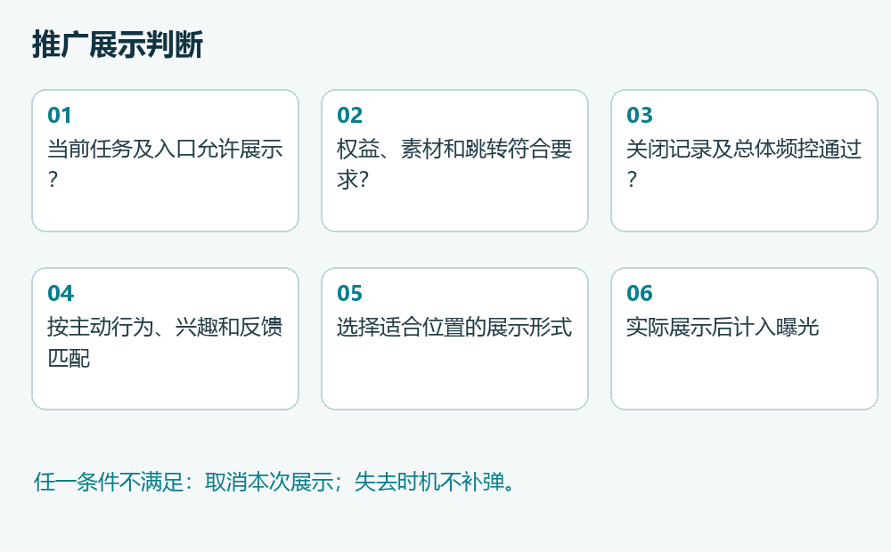
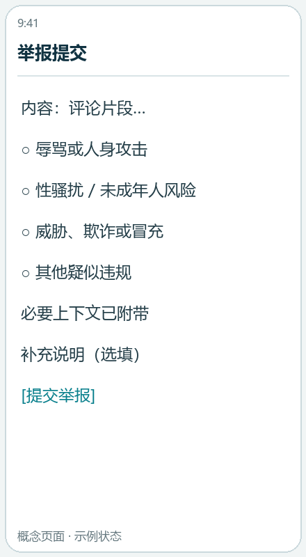
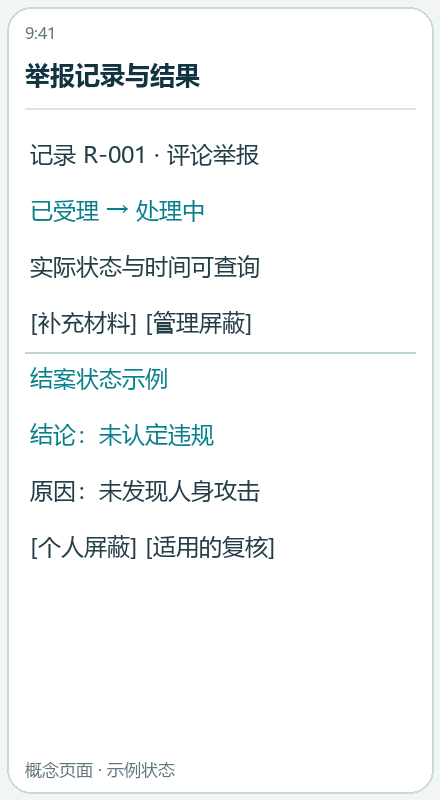

# 网易云音乐｜从用户反馈到产品需求

个人课程项目 · 用户研究与需求设计

围绕手机端找歌、听歌和社区互动，完成问卷整理、需求分析和竞品机制比较，形成三个方案方向，并在产品需求文档中明确业务规则、交互流程、效果指标与验收标准。

159 回收问卷 | 110 保留样本 | 30 公开反馈 | 12 需求组

## 我的工作

设计问卷并整理结果，归纳问题与需求，结合实际使用、截图和操作经过核对现有能力，比较竞品机制，编写产品需求文档。

## 研究链路

问卷与公开反馈 → 七类问题 → 12个需求组（R01含两个子项）→ 场景核对与范围选择 → 竞品机制比较 → 三项方案及验收要求。

## 方案方向

歌手作品完整浏览与整理、听歌流程推广干扰控制、评论及陌生互动举报反馈。推广控制为重点体验方案，作品关联为配套改进，举报反馈承担安全与信任保障。

## 交付与边界

已完成调研、需求、竞品分析及PRD，包含流程、概念页面、规则和验证计划。产品尚未上线，业务效果需要后续测试与灰度验证。

---

# 需求分析｜从问题线索到可实施范围

问卷判断关注程度，具体场景确认设计缺口

| 观察项 | 样本结果 | 设计输入 |
| --- | --- | --- |
| 广告、弹窗或活动提示 | 51/110人，46.4%；评分2.50/5 | 核对推广的时机、区域与重复触达 |
| 页面信息或入口问题 | 37/110人，33.6% | 核对首屏识别和关键功能路径 |
| 主要使用功能 | 搜索109人、个人音乐72人、推荐64人 | 同时保障主动查找与推荐探索 |
| 评论与社区 | 65份实质开放意见中提及6次 | 结合个案核对退出、举报和查询 |

## 需求怎样形成

将反馈整理为“用户要完成什么、在哪里遇到障碍、受到什么影响、需要怎样的结果”。例如推广遮挡歌曲信息，对应的需求是查看信息和操作时保持区域可用。

## 为什么选择这三项

综合问题严重程度、证据强度、影响范围和实施依赖。推广兼具样本线索和连续任务记录；举报关系到安全与持续反馈；作品关联有具体漏项及可复用的修复路径。

## 优先级与保留项

举报反馈为P0基础保障；推广控制和作品关联为P1。版权采购、复杂跨端同步等留在需求池，需进一步确认资源与依赖。三项方案分别对应R07，R02/R03及R08相关部分，R09/R10相关部分。

## 数据使用范围

8份因硬性质控问题排除，另41份经进一步筛选未纳入。年轻学生占比较高；公开反馈为定性材料。问卷关注程度与单次操作记录分别使用，留存和收入变化通过后续实验验证。

---

# 竞品分析｜把机制转成设计规则

QQ音乐与Spotify为核心比较对象，专项参照补充具体机制

| 主题 | 参考机制 | 进入PRD的设计 |
| --- | --- | --- |
| 作品关联 | Spotify合集与Appears On；TuneCore的参加作品 | 保留Various Artists，补全确认的艺人参与关系 |
| 推广控制 | QQ音乐个性化设置；Spotify偏好反馈与广告组频控 | 分别管理匹配、关闭和频次，保障关键任务 |
| 举报反馈 | Spotify举报说明与互动控制；YouTube举报历史 | 记录持续可查，状态有含义，结案解释并提供后续选择 |

## 作品关系的启发

同一内容可以保留合集署名，并沿参与艺人路径被发现。发行公司、专辑艺人和歌曲参与者分开核对；仅参与部分歌曲时说明参与范围。

## 推广规则的取舍

提高匹配程度与控制曝光频率分别设计。Spotify广告组频控只覆盖相应投放范围；本方案增加跨页面、跨活动形式的总体打扰控制。关闭个性化仍须遵守基本展示规则。

## 举报状态的启发

YouTube“Live”状态可能包含尚未审核或未认定违规，其记录覆盖也有限。本方案区分已受理、处理中与结案，逐一解释结论，并保留个人屏蔽和适用的复核入口。

## 资料范围

竞品依据官方帮助、隐私指引和广告规格；核对日期为2026-11-01。不同地区、版本及权益分别确认，客户端任务实测列入后续验证。完整来源与适用边界见竞品分析报告。

---

# 方案一｜补全参与关系，沿主页找到作品

歌手作品完整浏览与整理 · P1配套建议

## 问题场景

日文版《メメントモリ Lament Collection Vol.4》可单独搜索，合集署名为Various Artists。BOI主页专辑列表可找到英文版，日文版在该路径中遗漏。歌曲参与署名和发行资料用于核对关联。

## 设计范围

保留合集真实署名，区分歌曲参与者、专辑艺人和发行主体。确认参与关系后补齐艺人—专辑索引，复用现有主页与专辑列表；不同语言的独立发行版本分别保留。

## 核对与修复流程

比对歌曲署名、专辑元数据与艺人索引，生成缺失关联项。角色及范围一致时补齐；有冲突的差异项转内容运营复核。更新索引与缓存，保留变更依据并支持撤销误关联。

## 验收与指标

使用明确参与关系的合集样本，检查关联覆盖、错关联、部分参与和语言版本区分；执行从艺人主页找到指定合集的任务，记录成功与查找步骤。

---

# 方案二｜保障听歌任务，匹配推广内容

听歌流程推广干扰控制 · P1重点体验方案

## 主线任务与实际影响

启动 → 找歌或识曲 → 播放 → 查看信息或评论 → 返回播放器。记录中音频继续播放，大推广卡片仍占用音乐展示区域；返回前台的全屏推广和跨页面引导增加关闭与恢复成本。

## 位置、时机与明确操作

搜索、识曲、切歌、支付、举报及恢复播放器期间保护任务。适合展示时，推广卡片放在歌曲信息与控制区之外；关闭与跳转热区分离，日常刷新、浏览及持机动作维持原有用途。

## 个性化与入口保障

在权益和展示条件满足后，再结合主动行为、明确兴趣与反馈匹配内容。搜索、识曲和个人音乐入口保持可发现；用户可主动设置启动页面与可选模块顺序，推荐排序尊重这些设置。

---

# 推广规则｜频控、拒绝反馈与效果判断

统一展示判断，分别衡量任务、接受度与商业表现

## 展示判断

当前任务 → 权益及素材 → 关闭记录与总体频次 → 内容匹配 → 合适形式 → 实际曝光。条件不满足时取消本次展示；失去时机的请求不排队补弹。

## 关闭与拒绝

同一活动被关闭后，本次会话跨页面、跨素材停止被动展示。不感兴趣跨会话生效至活动结束或用户恢复；减少同类同时降低频次与排序。商业广告、会员促销、活动及自动阻断型引导共用打断预算。

## 返回与权益说明

从后台回来时恢复当前页面、歌曲、队列及用户最新播放意图。会员歌曲权限和免费时长分别提示；用户主动选择激励广告前说明条件、奖励与外部跳转，返回后重新检查权益。

## 效果与取舍

任务完成率纳入失败和放弃，耗时包含广告与加载。结合误触、关闭、负反馈、有效转化及每次使用收益判断；广告停留时长仅作辅助。以同期对照、小范围灰度检验收益与体验，目标值由基线确定。

---

# 方案三｜受理可追踪，结案有说明

评论及陌生互动举报反馈 · P0基础保障

## 即时处理与受理

评论、私信或一起听中，用户可先退出并自主选择隐藏或屏蔽，再决定是否举报。服务端确认受理后建立编号和可查询记录；失败保留草稿，超时先核对受理状态，避免重复提交。

## 进度与记录

已受理表示等待处理，实际开始后进入处理中；需要补充时给出材料要求和期限。系统通知链接同一记录，通知送达失败仍可查询。排队或处理中超时均提供延迟说明并进入内部升级。

## 全类型结案与选择

已采取措施、未认定违规、材料不足等结论均反馈原因及时间。“未认定违规”可说明未发现人身攻击等判断依据，并保留个人隐藏、屏蔽及适用的补充或复核入口。

---

# 交付与验证｜将问题、设计和验收对应

四份文档形成连续链路，指标用于后续验证

| 交付物 | 主要内容 | 与后续环节的关系 |
| --- | --- | --- |
| 用户调研报告 | 问卷统计、公开反馈、场景与证据边界 | 定位问题主题并追溯来源 |
| 需求分析 | 七类问题、12个需求组、任务及实施约束 | 说明三项方案的选择依据 |
| 竞品分析 | 作品关系、推广控制、举报机制及适用边界 | 将参考机制转成设计输入 |
| 产品需求文档 | 业务规则、流程、页面状态、异常、指标与验收 | 明确研发评审和测试范围 |

## 验证安排

先按账号权益、首页模式、入口及网络条件建立基线，再进行原型任务测试与技术评审。推广用同期对照比较任务成本及商业表现；作品关联与举报反馈分别检查准确性和记录完整性。

## 关键验收

作品：已确认关联能被找到且署名准确。推广：保护任务、信息与入口，拒绝记录生效。举报：受理后持续可查，所有结案路径都有说明，个人屏蔽独立生效。

## 结果口径

当前成果为研究与需求设计。问卷、公开反馈及操作记录支持问题识别；留存、转化和收入收益列为待验证假设。公开材料仅包含汇总数据。

## 主要参考入口

Spotify：合集组织、广告偏好、举报与互动说明；QQ音乐：隐私指引；TuneCore Japan：BOI参加作品；YouTube：举报历史。各来源链接及核对日期列于竞品分析报告。

---
