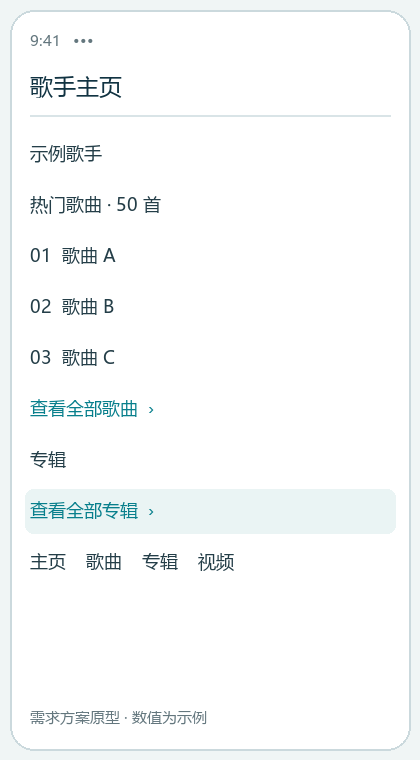
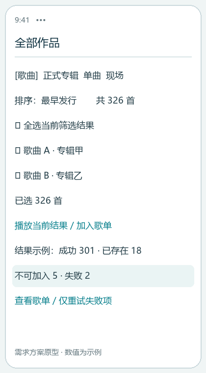
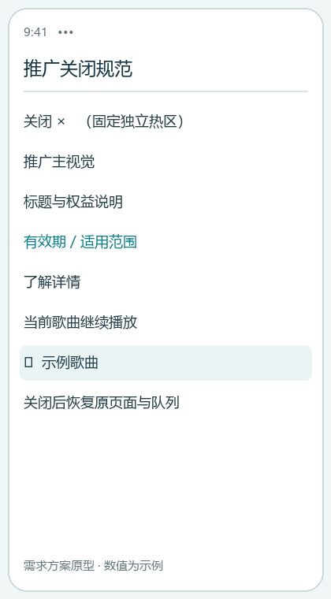
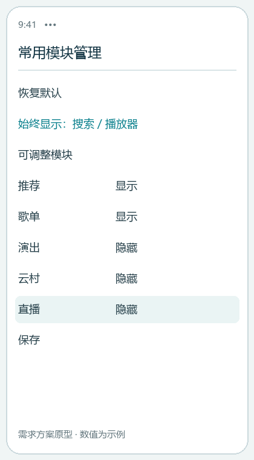
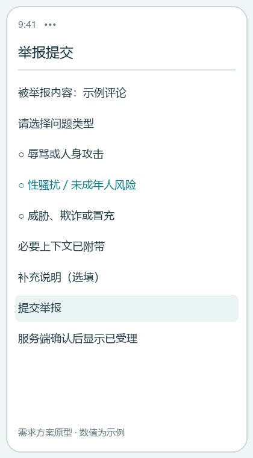
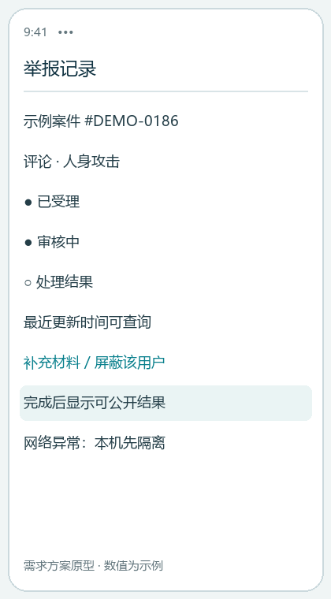

# 网易云音乐｜从用户反馈到功能方案

产品研究与需求设计 · 2026.08—2026.09

围绕手机端找歌、连续听歌和社区互动，整理问卷与公开反馈，比较 QQ 音乐和 Spotify，并形成带流程、页面状态、业务规则和验收标准的产品需求文档。

159 回收问卷 | 110 最终保留样本 | 30 公开用户反馈 | 12 需求组

## 我的工作

问卷设计与结果整理、问题归类与关联分析、需求评分、竞品对比、三项功能 PRD。

## 交付状态

研究与需求方案已完成。页面为概念原型，功能尚待现网复测、技术评审和验证；指标与灰度流程为设计方案。

## 样本边界

19 道问卷题；18—30 岁 101 人（91.8%），学生 83 人（75.5%），男性 79 人。样本来自关系网络及转发渠道，结论适用于本次样本。

## 证据如何使用

问卷提供影响范围与群体差异；30 条公开反馈补充具体任务场景。两类材料相互校验，关联结果保留因果解释边界。

---

# 研究发现｜区分常见摩擦与行为后果

基于 110 份保留样本

| 证据 | 观察结果 | 产品含义 |
| --- | --- | --- |
| 搜索使用 | 109 / 110 人 | 优先保留清晰的查找与播放路径 |
| 广告干扰 | 51 人（46.4%）；评分 2.50 / 5 | 频次、展示时机、关闭和任务恢复应统一管理 |
| 页面与入口 | 37 人（33.6%）；易用评分 2.95 / 5 | 支持高频入口和可配置模块 |
| 曲库问题 | 25 人；其中 23 人报告行为或付费变化 | 高任务影响；产品方案需区分版权依赖与界面能力 |
| 会员已过期 | 32 人中 30 人同时使用竞品 | 单独观察续费与价值感知 |
| 推荐重复 | 64 名推荐用户中 24 人选择重复 | 保留匹配优势，增加探索与反馈控制 |

## 分析方法

分类关联采用 3,000 次置换检验，报告 Cramer’s V；评分与意愿的组间差异报告 epsilon²。对 34 项检验使用 Benjamini–Hochberg FDR 校正。

## 解释约束

广告问题较常见，但其与行为变化的关联在 FDR 校正后未达到显著水平。推荐重复集中于仍在活跃使用的用户，结果受问题暴露机会影响。

## 保留已有优势

推荐匹配、歌词同步、播放稳定性和评论故事获得正向反馈。改进重点指向任务中的明确缺口。

---

# 需求收敛｜从 12 个需求组到三项方案

评分结果与最终 PRD 范围分别记录

| 最终方案 | 对应需求 | 取舍与优先级 |
| --- | --- | --- |
| 歌手作品完整浏览与整理 | R07 | P1；入口、分类、排序及批量操作范围可落地 |
| 推广干扰控制与模块管理 | R02 / R03 | P1；先完成当前版本与会员状态复测 |
| 评论及陌生互动举报反馈 | R09 / R10 | P0；安全与信任，优先形成可查询闭环 |

## 评分框架

影响范围、任务影响、行为影响和证据强度各 1—3 分；直接阻断核心任务或涉及安全的需求进入 P0。R01 包含 A / B 两项子需求，合计 12 个需求组、13 条评分记录。

## 方案修订

早期方案考虑版权解释、云盘批量管理和跨端同步。随后重新检查产品已有能力及具体反馈，将研发依赖较强或证据不足的复杂机制移出最终范围。评分记录保留为决策历史。

## 竞品启发

QQ 音乐作为国内直接竞品，比较检索、内容与会员体系；Spotify 作为产品模式参照，比较资料库组织、推荐控制和跨设备任务。相关观察按 2026 年 8 月 20 日资料截点记录。

## 从对比到产品决策

将功能数量比较转化为任务检查：能否识别作品范围、继续原听歌任务、查询举报处理阶段。版权供给、跨端同步和商业收入分别列出依赖与验证门槛。

---

# 方案一｜找到作品，确认操作范围

P1 · 歌手作品完整浏览与整理

## 主流程

歌手主页 → 全部歌曲 / 全部专辑 → 类型与发行时间筛选 → 播放当前结果或批量加入歌单 → 查看处理明细。

## 关键规则

热门模块明确“热门 50 首”；全部作品入口清晰可达。作品类型不明时归入“其他”。批量处理默认去重，分别反馈成功、已存在、不可加入和失败数量。

## 异常与恢复

分页与后台任务保证大列表可操作；返回页面保留筛选和滚动状态。部分失败支持仅重试失败项，幂等控制避免成功项重复写入。

## 验收与指标

验收核对入口、筛选、播放范围和批量结果。观察完整入口到达率、查找任务完成率、批量成功率和失败项恢复率。

---

# 方案二｜推广关闭后继续原任务

P1 · 当前正式版本复测为前置条件

## 展示决策

推广请求依次检查当前任务、播放状态、会话 / 日频次、最近关闭记录、会员权益及素材有效性。普通推广在不适合打断时延后或进入非阻断区域。

## 关闭与频控

同一推广在一次会话内被关闭后停止重复弹出；后台超过 30 分钟结束会话。关闭热区固定、与跳转热区隔离，最小可点击区域按 PRD 为 44 × 44 pt。

## 模块与权益

搜索、播放器、安全和账号入口保持可达；非核心模块允许隐藏、排序和恢复默认。会员权益异常采用低干扰兜底。安全通知独立管理。

## 复测及衡量

按未登录、免费、VIP、SVIP × 启动 / 返回 / 切歌等场景 × 网络状态复测。同期观察重复推广率、任务恢复、关闭误跳转和商业转化。

---

# 方案三｜让举报处理过程可查询

P0 · 评论与陌生互动安全

## 分流与状态

明确违规进入举报；无关内容进入质量反馈；个人偏好进入不感兴趣。举报在服务端返回案件编号后显示已受理，再进入审核中、待补充和处理结果。

## 即时保护

退出与本机屏蔽优先执行；断网时先隔离，再同步。屏蔽代表个人接触控制。案件审核依据证据与规则进行，举报数量用于线索聚合。

## 隐私和异常

失败请求保留草稿；重复提交指向原案件并允许补充。结果只公开必要类别；通知未送达时仍可从记录中心查询。

## 验收与指标

核对编号、状态一致性、补充材料、可查询结果及离线隔离。观察受理成功率、受理确认时长、处理时长、结果可见率和再次接触阻断失败率。

---

# 验证计划与交付证据

设计可验证的后续步骤

| 阶段 | 验证内容 | 决策条件 |
| --- | --- | --- |
| 现状核验 | 当前版本复测；14 天指标基线 | 移除已解决或无法复现的问题 |
| 小范围灰度 | 各功能分阶段开放，保留回退开关 | 同步评估任务体验、性能、商业及安全 |
| 效果评估 | 检查成功率、异常、处理时长与护栏 | 依据基线确定目标；重大失败时暂停扩量 |

## 交付材料

用户研究汇总、需求分析与优先级矩阵、QQ 音乐 / Spotify 竞品分析、完整版 PRD；中英文案例与六组可视化概念原型。

## 需求可追溯

场景 → 流程 → 原型 → 埋点 → 验收逐项对应。完整版 PRD 第十六节保留对应表，展示版将三条任务链路单独说明。

## 实施依赖

内容元数据与歌单服务、客户端与广告 SDK、会员权益服务、审核状态接口、客服运营与数据团队。每项依赖都对应失效处理。

## 项目性质

个人产品研究项目，以网易云音乐手机端为研究对象。交付内容包括用户研究、需求分析、竞品分析、功能方案和概念原型。

## 项目入口

https://github.com/Ginga2003/netease-cloud-music-product-case

---
