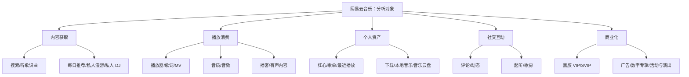
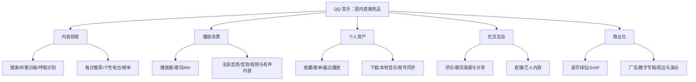
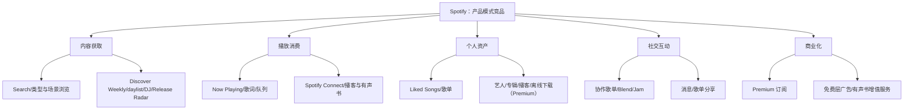
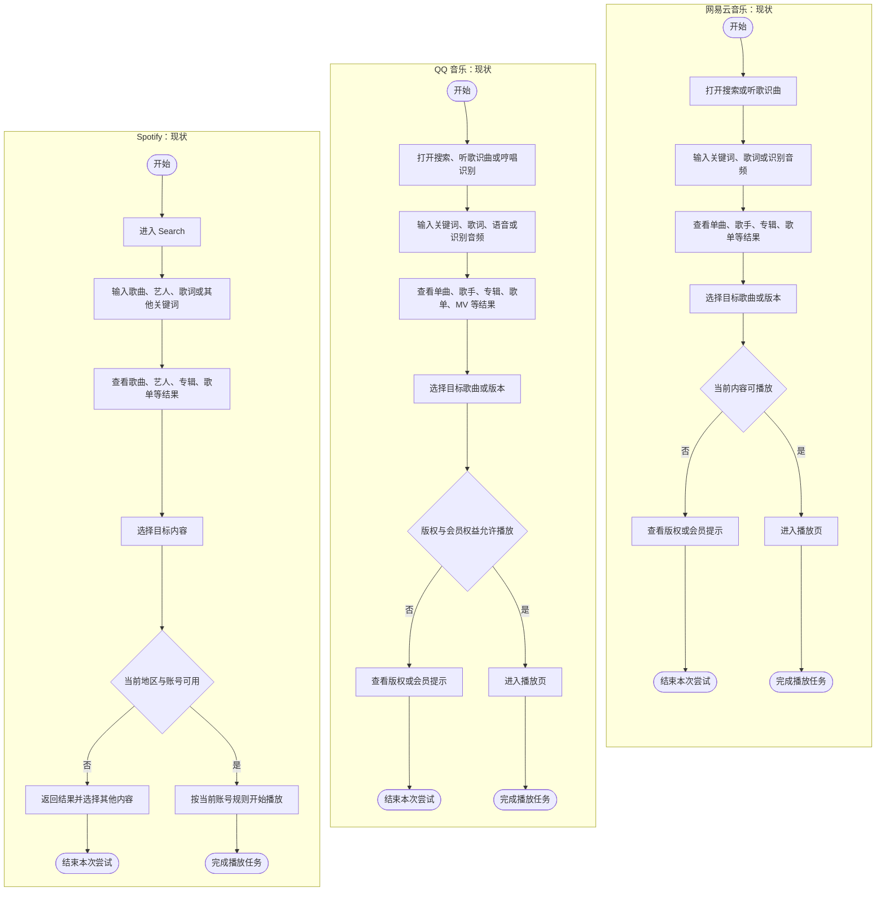
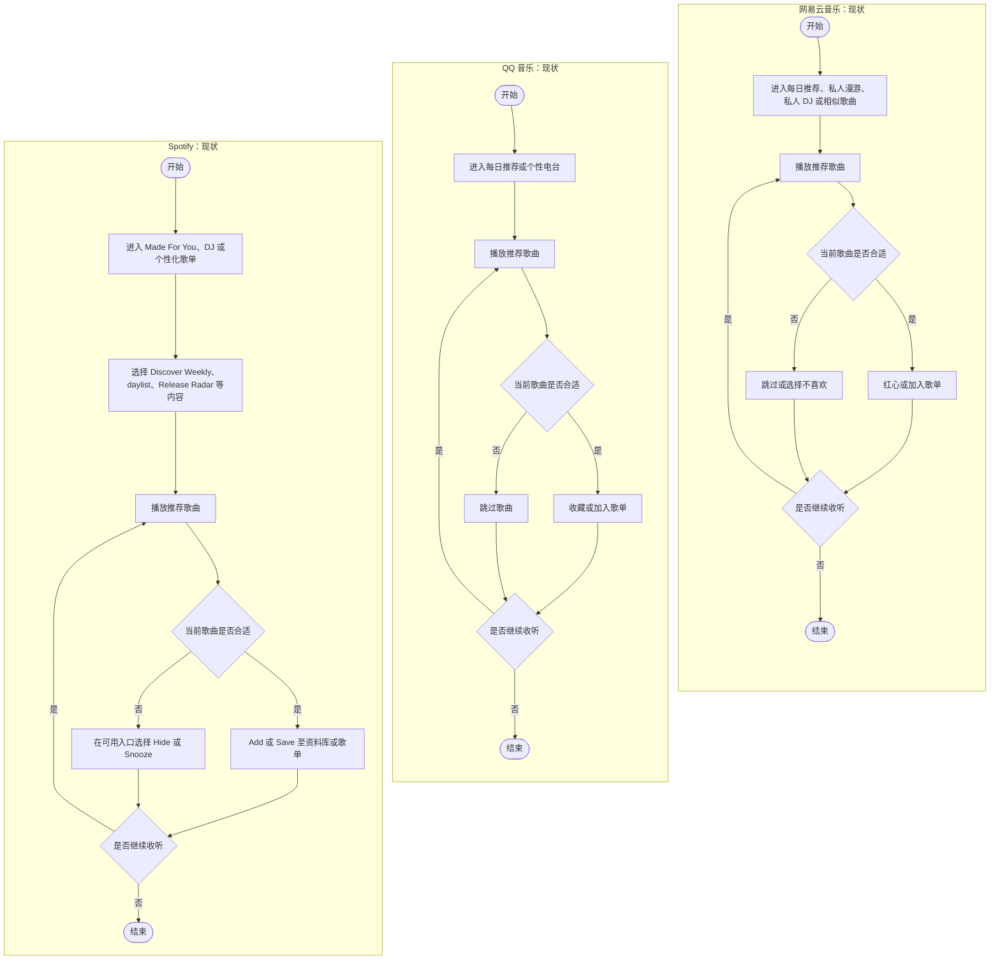
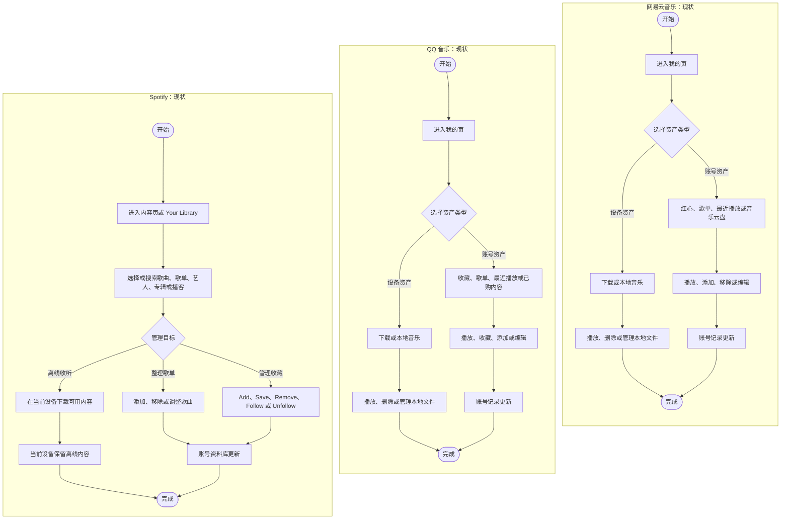
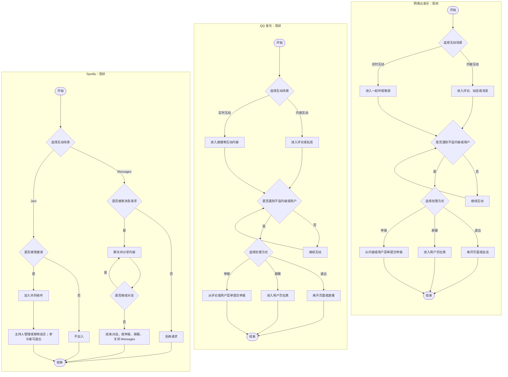
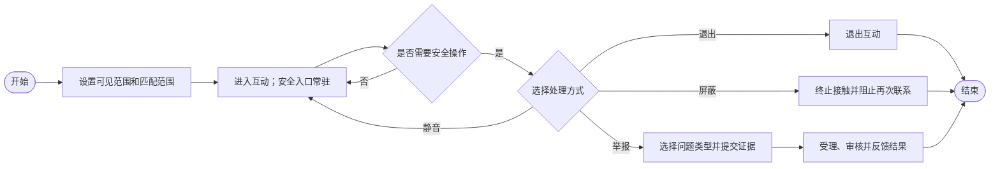

> 原始项目文档公开整理版。观察结果保留原文资料截点；最终方案为 2026-09-12 完整版 PRD。页面及指标均按原文交付状态解读。

# 网易云音乐 App 竞品分析报告

**研究对象：** 网易云音乐手机端  
**核心竞品：** QQ 音乐、Spotify  
**资料截点：** 2026 年 8 月 20 日  
**版本参考：** 网易云音乐 iOS 9.5.70、QQ 音乐 iOS 20.7.5、Spotify iOS 9.1.74  
**调研基础：** 110 份有效问卷、30 条公开用户反馈

## 一、调研背景及目的

截至 2025 年 12 月，我国网络音乐用户规模为 7.3043 亿，占网民的 64.9%。本次分析把内容供给、核心任务完成率、推荐效率、个人音乐资产和付费转化作为主要观察项。

网易云音乐 2025 年在线音乐服务收入为 59.944 亿元，同比增长 12.0%；会员订阅收入为 50.527 亿元，同比增长 13.3%。同期总收入为 77.595 亿元，毛利率由 33.7% 提升至 35.7%。在线音乐服务和会员订阅已成为收入增长的主要来源。

前期需求分析共形成 12 个需求组，其中 R01 需求组包含 R01-A“准确找到并识别目标音乐版本”和 R01-B“明确不可播放原因并获得后续路径”；R01 需求组与 R10“社交场景的安全与举报闭环”为 P0。本次竞品分析以该需求结果为依据，考察 QQ 音乐和 Spotify 的产品结构、核心功能、近期迭代、运营方式及商业模式，为网易云音乐后续方案设计提供参照。

本次分析的具体目标为：

1. 比较网易云音乐与两款竞品对搜索播放、个性化发现和个人音乐管理三项核心任务的处理方式。
2. 判断产品结构、运营入口和会员体系对 R02、R03、R08 的影响。
3. 分析 2025—2026 年网易云音乐与两款竞品的迭代方向及其与用户需求的对应关系。
4. 形成可回收到需求方案和指标设计中的竞品结论。

## 二、用户分析

### 2.1 用户构成与使用状态

110 份有效样本中，18—30 岁用户 101 人，学生 83 人，男性 79 人。使用网易云音乐 3 年以上的用户共有 83 人，占 75.5%。53 人将网易云音乐作为最常用音乐 App，43 人仍在使用但已经更换首选平台，14 人已经停止使用。样本以年轻长期用户为主，同时包含继续首选、降低使用和停止使用三种状态。

### 2.2 核心使用目标与行为

| 使用目标 | 主要场景 | 典型行为 | 体验关注点 |
| --- | --- | --- | --- |
| 播放明确目标音乐 | 想听指定歌曲、歌手、专辑或特定版本 | 搜索、听歌识曲、辨认版本并进入播放 | 搜索准确性、版本识别、版权状态和播放成功率 |
| 保持连续收听 | 学习或工作、独处或休息、通勤 | 打开歌单或推荐后持续播放 | 广告干扰、播放稳定性和操作连续性 |
| 发现新的音乐内容 | 缺少明确目标，希望获得符合当前偏好的歌曲 | 使用每日推荐、私人漫游等功能，收藏或跳过歌曲 | 推荐准确度、新鲜度、重复率和反馈控制 |
| 管理个人音乐 | 收藏歌曲、整理歌单或更换设备 | 添加红心、编辑歌单、下载和跨端查看 | 整理效率、同步一致性和长期保存 |
| 参与音乐互动 | 阅读评论、分享歌单或使用一起听 | 浏览、发布、分享及与其他用户互动 | 内容质量、隐私范围和社交安全 |

搜索是覆盖范围最广的使用行为，110 名受访者中有 109 人将其列为主要使用功能。个人音乐管理和个性化推荐分别有 72 人和 64 人选择。连续收听主要发生在学习或工作、独处或休息、通勤场景，对应人数分别为 67 人、64 人和 56 人。

### 2.3 平台选择与使用变化

近三个月同时使用其他音乐 App 的受访者共有 80 人，其中 32 人使用 QQ 音乐，25 人使用 Spotify，24 人使用 Apple Music。多平台并用与首选平台变化同时存在，竞品对比需要考察不同产品在搜索播放、推荐发现和个人音乐管理任务中的差异。

## 三、竞品选择与对比框架

### 3.1 竞品选择

网易云音乐是本报告的分析对象和现状基准。QQ 音乐与网易云音乐面向相近的中文音乐用户，产品范围覆盖曲库、音质、歌单、社区和会员，是国内直接竞品。Spotify 的个性化推荐、统一资料库和跨设备播放具有明确的产品特征，作为产品模式竞品。

QQ 音乐用于比较国内内容供给、多方式检索、音质和会员体系；Spotify 用于比较推荐控制、资料库组织和跨设备使用。两款竞品分别覆盖国内直接竞争和产品模式差异。

### 3.2 对比范围与选择理由

| 分析模块 | 对应需求 | 对比内容 | 选择理由 |
| --- | --- | --- | --- |
| 产品结构 | R03、R08 | 核心入口、内容层级、个人资产和商业化模块 | 页面信息密度与会员入口直接影响高频任务的可达性 |
| 核心功能 | R01 需求组、R04、R05 | 搜索播放、个性化发现和个人音乐管理 | 三项功能对应找到音乐、发现音乐和保存音乐，构成听歌主链路 |
| 社交安全 | R10 | 接触范围、退出、屏蔽、举报和结果反馈 | 陌生人互动中的安全问题属于 P0 需求 |
| 产品迭代 | R01 需求组、R04、R05、R08 | 2025—2026 年功能更新及投入方向 | 迭代内容能够反映各产品当前的能力重点 |
| 运营与商业模式 | R02、R08 | 用户参与、传播、广告、订阅和增值服务 | 广告干扰和会员权益同时影响使用体验与收入 |

## 四、产品定位与结构分析

网易云音乐与两款竞品均按“内容获取、播放消费、个人资产、社交互动、商业化”五类功能绘制结构图。

### 4.1 网易云音乐（分析对象）

网易云音乐将音乐曲库、个性化推荐、用户歌单、歌曲评论、云村社区和音乐云盘组织在同一产品中。产品定位侧重音乐发现、情绪表达和个人音乐记录。

### 4.2 QQ 音乐（国内直接竞品）

QQ 音乐强调正版曲库、无损音质、多方式搜索、车载互联、视频、有声内容和个性化推荐。腾讯音乐将 QQ 音乐定位为面向高参与和高付费意愿用户的综合音乐服务。

### 4.3 Spotify（产品模式竞品）

Spotify 以 Home、Search、Your Library 和 Now Playing 承担推荐、主动查找、个人资产和播放控制。Your Library 统一保存歌曲、专辑、艺人、播客和歌单。

### 4.4 结构对比

| 对比维度 | 网易云音乐 | QQ 音乐 | Spotify | 对网易云音乐的影响 |
| --- | --- | --- | --- | --- |
| 内容获取 | 主动搜索与推荐并重，评论和歌单继续延伸内容 | 多方式搜索、个性电台和榜单共同组织内容 | 搜索与算法歌单职责清楚 | R03 需要稳定搜索、推荐和个人音乐的核心入口 |
| 播放消费 | 播放器连接歌词、评论、音效和视觉表达 | 音质、MV、视频和会员权益结合较深 | 播放控制、队列和跨设备功能集中 | 播放页新增内容应服从当前听歌任务 |
| 个人资产 | 红心、歌单、最近播放、下载、本地和云盘并存 | 收藏、歌单、下载及账号多端同步 | Your Library 统一管理主要收藏对象 | R05 需要统一跨来源操作和同步状态 |
| 社交互动 | 评论、动态和一起听进入音乐消费链路 | 评论、分享、直播和艺人内容共同形成互动入口 | 协作歌单、Jam 和消息围绕共同收听 | R10 需要覆盖公开、半公开和陌生人互动 |
| 商业化 | 会员、广告、数字专辑、活动和演出并行 | 会员层级、数字内容、周边和演出较多 | 免费层与 Premium 的边界相对集中 | R08 需要按用户任务说明权益适用范围 |

## 五、核心功能与交互流程对比

### 5.1 R01 需求组（包含 R01-A、R01-B）：目标音乐检索与播放

#### 当前任务流程

| 观察点 | 网易云音乐 | QQ 音乐 | Spotify |
| --- | --- | --- | --- |
| 搜索输入 | 文本、歌词和听歌识曲覆盖主要输入方式 | 文本、歌词、识曲和哼唱覆盖更多模糊输入场景 | 文本搜索与类型浏览结合 |
| 结果组织 | 单曲可继续进入评论、歌单和相似歌曲；版本混排会增加识别成本 | 分类结果与歌手、专辑、MV、音质和会员服务衔接 | 搜索结果与艺人、专辑、歌单和资料库使用同一内容分类 |
| 不可播放处理 | 版权或会员状态能够说明限制，替代内容和恢复路径仍需补充 | 权益提示与会员购买链路较完整，用户需要识别不同权益范围 | 可用性受地区和账号条件影响，搜索后的内容延伸较简洁 |
| 设计判断 | 内容延伸能力较强，版本识别和失败后的下一步影响任务完成 | 输入方式和国内内容服务适合处理明确找歌任务 | 结果分类和资料库关系清楚，适合作为信息组织参照 |

#### 网易云音乐设计输入

搜索结果按正式版本、现场版、翻唱、伴奏和节目分组，并在结果层直接显示版权及会员状态。目标版本不可播放时，页面提供同专辑可播放版本、版权恢复提醒和云盘匹配入口。搜索流程的评价指标采用搜索后播放成功率、版本误播率、无结果率和搜索后转出率。

### 5.2 R04：个性化音乐发现

#### 当前任务流程

| 维度 | 网易云音乐 | QQ 音乐 | Spotify |
| --- | --- | --- | --- |
| 推荐入口 | 每日推荐、私人漫游、私人 DJ 和相似歌曲 | 每日推荐、个性电台、今日 FM 和榜单 | Discover Weekly、daylist、DJ、Mixes 和 Release Radar |
| 显式控制 | 多入口分别承载熟悉内容、漫游和场景推荐 | 用户可在“我的音乐偏好”中调整偏好标签 | Discover Weekly 类型控制、DJ 请求和 Release Radar 会话控制提供直接调节 |
| 负反馈 | 红心、跳过和不喜欢提供基础反馈 | 收藏和跳过提供基础反馈 | Hide 和 30 天 Snooze 能够区分当前歌单排除与短期暂停推荐 |
| 推荐说明 | 评论、歌单和播放器氛围增强内容语境 | 推荐、榜单和精选内容共同组织发现入口 | 算法歌单以类型、时段和更新周期说明推荐场景 |
| 需求对应 | 推荐符合偏好平均分为 3.84，新鲜度与多样性为 3.30 | 偏好标签提供长期方向控制，单曲负反馈仍以基础操作为主 | 显式控制较细，但部分功能受会员、语言和地区限制 |

Spotify 于 2025 年为 Discover Weekly 增加类型控制，并以 30 天 Snooze 暂停特定歌曲进入推荐；DJ 支持语音或文字请求。2026 年的 Prompted Playlist 和 Release Radar 更新继续增加自然语言、歌单刷新频率和内容筛选控制。

#### 网易云音乐设计输入

推荐入口增加“熟悉”“探索”“小众”和“当前情绪”四类模式。播放中的负反馈细分为“听腻了”“风格不符”“版本不对”和“热门内容过多”，分别调整重复周期、风格标签、版本偏好和热门内容比例。推荐页显示主要推荐依据，并允许用户修改具体兴趣标签。

### 5.3 R05：个人音乐资产管理

#### 当前任务流程

| 维度 | 网易云音乐 | QQ 音乐 | Spotify |
| --- | --- | --- | --- |
| 资产范围 | 红心、歌单、最近播放、下载、本地音乐和云盘 | 收藏、歌单、最近播放、已购内容、下载和本地音乐 | Liked Songs、歌单、艺人、专辑、播客和 Premium 离线下载 |
| 信息组织 | 云盘能够补充平台曲库，多种来源的操作规则存在差异 | 账号体系覆盖手机、电脑、车载等终端 | Your Library 使用统一入口、筛选和排序管理主要收藏对象 |
| 批量管理 | 歌单和云盘的跨来源批量整理仍有操作成本 | 收藏和歌单管理较完整，本地与下载内容受设备及版权限制 | 资料库结构集中，个人文件云端管理能力弱于网易云音乐 |
| 同步与设备 | 跨端状态、失败项和冲突处理需要统一呈现 | 账号资产可供多端使用，下载和本地内容仍由设备管理 | 账号资料库在登录设备间更新，离线下载保留在当前设备 |
| 设计判断 | 云盘和长期听歌记录具有差异化价值，统一管理是主要改进方向 | 适合参考账号与多终端连续使用 | 适合参考统一资料库入口和筛选方式 |

#### 网易云音乐设计输入

“我的”页面统一红心、歌单、最近播放、下载、本地音乐和云盘的常用操作。用户新增或编辑个人音乐后，系统显示同步状态；出现冲突时列出设备、修改时间和差异，提供保留、覆盖或合并选项；失败结果按歌曲和设备返回原因。评价指标采用跨端同步成功率、冲突解决率、批量任务完成率和同步投诉量。

### 5.4 R10：社交互动的安全约束

#### 当前安全控制流程

| 维度 | 网易云音乐 | QQ 音乐 | Spotify |
| --- | --- | --- | --- |
| 主要触点 | 评论、动态、消息、一起听和歌房 | 评论、私信、直播及分享内容 | Messages、Jam、Blend 和协作歌单；Messages 受年龄和开放地区限制 |
| 互动前控制 | 不同入口分别处理公开内容、消息和实时互动 | 评论、私信和直播沿用各自的进入规则 | 消息请求需要接受；Jam 通过邀请链接、二维码或近距离方式加入 |
| 互动中控制 | 用户可退出会话，并通过内容菜单或用户页处理不适互动 | 用户可离开互动入口，并对评论或用户执行举报、拉黑 | 消息支持举报、屏蔽和整体关闭；Jam 主持人可移除成员，参与者可退出 |
| 设计判断 | 社交触点较多，安全入口和处理结果需要统一 | 评论、私信和直播的控制路径分散在不同页面 | 请求确认、成员管理和整体关闭形成较清楚的权限边界 |

网易云音乐的安全控制需要覆盖互动前的接触范围、互动中的即时退出和屏蔽，以及举报后的处理反馈。

#### 网易云音乐目标安全流程

## 六、产品迭代分析

| 时间 | 产品 | 主要迭代 | 迭代方向 | 对应需求 |
| --- | --- | --- | --- | --- |
| 2025 年 | 网易云音乐 | 私人 DJ、红心歌曲分类、Climber 音乐成长计划、Automix 等功能持续更新 | 音乐发现、个人记录和播放体验 | R04、R05 |
| 2026 年 6—8 月 | 网易云音乐 | AI 调音、情绪音效、世界漫游播放器、播放页 MV 和相似歌曲入口 | 播放氛围、视听表达和推荐延伸 | R04、R11 |
| 2025 年 | QQ 音乐 | AI Agent 处理自然语言找歌及复杂任务，并连接数字专辑和周边购买 | AI 从检索延伸到播放与消费 | R01 需求组、R04、R08 |
| 2026 年 7—8 月 | QQ 音乐 | 识图推歌、语音评论、智能混音和 AI 播放器 | 多模态检索、互动和播放个性化 | R01 需求组、R04、R09、R11 |
| 2025 年 | Spotify | 推荐类型控制、Snooze、DJ 请求、Lossless 和消息等功能上线 | 推荐控制、音质与社交连接 | R04、R05、R11 |
| 2026 年 1—7 月 | Spotify | Prompted Playlist、DJ 请求和 Release Radar 控制更新 | 自然语言生成、刷新频率和推荐筛选 | R04 |
| 2026 年 8 月 | Spotify | Playlist Notes 支持编辑团队和用户为歌单内内容添加说明 | 推荐解释和歌单表达 | R04、R09 |

迭代方向显示，网易云音乐近期重点集中在播放器氛围、视听表达和推荐延伸；QQ 音乐将 AI 接入找歌、播放和消费任务；Spotify 持续增加推荐控制和歌单生成能力。前期需求中，R01-A 要求提高目标音乐版本识别，R01-B 要求明确版权状态和不可播放后的继续路径，R05 要求完善个人资产同步。网易云音乐的后续版本需要增加搜索结果治理、版权状态、同步反馈和冲突处理方面的可见改进。

## 七、运营分析

| 产品 | 运营目标 | 参与机制 | 用户沉淀资产 | 传播方式 | 转化路径 | 主要约束 |
| --- | --- | --- | --- | --- | --- | --- |
| 网易云音乐 | 提高音乐发现、内容参与和长期留存 | 每日推荐、年度听歌报告、评论、歌单、内容首发 | 红心、歌单、评论、听歌记录、云盘 | 乐评、歌单和年度报告分享 | 黑胶 VIP、SVIP、数字专辑、广告、活动与演出 | 活动、广告和弹窗可能打断启动及连续播放 |
| QQ 音乐 | 连接新歌、艺人、粉丝和多层会员消费 | 榜单、艺人合作、粉丝活动、音质体验、数字专辑 | 收藏、歌单、粉丝关系和购买记录 | QQ/微信生态、艺人活动和年度报告 | 绿钻、SVIP、数字专辑、周边、演出和广告 | 运营入口和权益层级增加理解成本 |
| Spotify | 用个性化发现和年度回顾促进回访与分享 | Discover Weekly、daylist、Wrapped、编辑歌单、Release Radar | Liked Songs、歌单、Blend、Jam 和收听历史 | Wrapped、Blend、消息及外部社交分享 | Premium、家庭与双人套餐、广告、有声书增值服务 | 个性化活动依赖数据解释、隐私控制和地区可用性 |

2025 年 Wrapped 的参与用户超过 3 亿，全球分享量超过 6.3 亿次。该活动把个人收听记录转化为可保存、可分享的内容。网易云音乐 2025 年平均 DAU/MAU 比率保持在 30% 以上，日均听歌时长继续上升，说明推荐、评论、歌单和个人记录已经具备稳定的参与基础。

网易云音乐的运营改进重点是控制触达对核心听歌任务的影响。开屏、返回弹窗和播放中的活动提示应分别设置频次及冷却时间，关闭后恢复原任务。运营效果同时考察曝光和点击、启动后退出率、连续播放中断率、短时重复曝光率及会员投诉量。

## 八、商业模式分析

| 产品 | 主要收入结构 | 2025 年经营数据 | 商业化特征 | 对应需求 |
| --- | --- | --- | --- | --- |
| 网易云音乐 | 会员订阅、数字专辑和单曲、内容转授权、广告、直播及虚拟物品 | 总收入 77.595 亿元；在线音乐服务收入 59.944 亿元；会员订阅收入 50.527 亿元；毛利率 35.7% | 会员订阅是在线音乐服务的主要收入，广告和数字内容补充变现 | R02、R08 |
| 腾讯音乐体系 | 订阅、广告、数字专辑、线下演出、艺人周边及社交娱乐服务 | 总收入 329.02 亿元；在线音乐服务收入 267.26 亿元；订阅收入 176.6 亿元；在线音乐付费用户 1.274 亿；SVIP 用户超过 2,000 万 | QQ 音乐通过曲库、音质、粉丝和多层权益覆盖不同付费深度 | R08 |
| Spotify | Premium 订阅、免费层音频与展示广告、有声书及增值服务 | 月活 7.51 亿；Premium 用户 2.90 亿；总收入 171.86 亿欧元，其中 Premium 153.50 亿欧元、广告支持 18.36 亿欧元 | 免费层承担获客和广告变现，Premium 以无广告、按需播放、离线和跨端权益转化 | R02、R08 |

会员订阅收入占网易云音乐在线音乐服务收入约 84.3%，占总收入约 65.1%。会员价值和用户预期直接影响主要收入来源。会员页需要按照目标歌曲、音质、广告减免、下载和设备等具体任务说明各等级权益，购买后显示权益生效状态和异常处理入口。

免费层承担用户获取和活跃维持，也承担广告收入。问卷中，从未开通过会员的 43 人里有 31 人选择广告问题，占 72.1%；该组广告体验平均分为 2.02。广告展示需要保留完整的搜索和播放主流程，并控制启动、返回及连续收听中的阻断次数。会员广告减免范围应列出适用广告类型和例外情况。

## 九、结论

### 9.1 竞品分析结论

QQ 音乐在国内内容供给、多方式检索、音质服务和多层会员体系方面形成综合能力，适合作为 R01 需求组和 R08 的直接参照。Spotify 将推荐控制、统一资料库和跨设备播放组织在较集中的产品结构中，可为 R04 和 R05 提供设计参照。网易云音乐的评论、歌单、云盘和长期听歌记录连接了内容发现、情绪表达和个人音乐资产，构成其主要差异。

本品与竞品的对比表明，网易云音乐的后续方案应先保证搜索结果的版本识别、版权状态和失败后路径，再改进推荐控制与个人资产同步。运营和会员设计需要服务于搜索、播放和收藏主链路，减少商业入口对连续听歌的干扰。陌生人互动的退出、屏蔽、举报和处理反馈作为 P0 安全能力进入基础方案。

### 9.2 需求回收

| 需求编号 | 优先级 | 竞品分析输入 | 网易云音乐方案方向 | 核心指标 |
| --- | --- | --- | --- | --- |
| R01 需求组（R01-A、R01-B） | P0 | QQ 音乐的多方式检索与内容服务；Spotify 的分类和资料库关系 | 版本分组、版权状态、可播放替代内容、恢复提醒和云盘匹配 | 搜索后播放成功率、版本误播率、无结果率、搜索后转出率 |
| R10 | P0 | 网易云音乐与两款竞品均包含公开、协作或半私密互动，安全控制需要覆盖不同接触方式 | 常驻退出、静音、屏蔽和举报入口，反馈受理及处理结果 | 风险场景退出时长、举报受理时长、重复违规率、结果送达率 |
| R02 | P1 | 免费层广告与会员转化并存，运营触达可能中断当前任务 | 设置频次、冷却时间和非阻断形式，关闭后恢复原任务 | 启动后退出率、重复曝光率、连续播放中断率、广告关闭率 |
| R03 | P1 | Spotify 的入口职责较集中；网易云音乐和 QQ 音乐承担更多内容及商业模块 | 稳定搜索、推荐、歌单和个人音乐入口，支持模块隐藏与排序 | 核心入口到达时长、误触率、任务完成率、模块隐藏率 |
| R04 | P1 | Spotify 的类型控制、Snooze 和刷新规则；QQ 音乐的自然语言找歌 | 推荐模式、细分负反馈、推荐依据和兴趣标签调整 | 重复率、连续跳过率、收藏率、模式使用率 |
| R05 | P1 | Spotify 的统一资料库；QQ 音乐的账号与多端连续使用 | 统一跨来源操作，显示同步状态、冲突差异和失败项 | 同步成功率、冲突解决率、批量任务完成率、同步投诉量 |
| R08 | P1 | QQ 音乐的多层会员与 Spotify 的免费增值边界提供两种权益组织方式 | 按歌曲、音质、广告、下载和设备说明权益并验证生效状态 | 权益投诉量、续费率、退款率、过期会员回流率 |

## 十、资料来源

以下资料用于核对行业规模、经营数据、产品版本及 2025—2026 年功能更新，访问日期均为 2026 年 8 月 22 日。

### 10.1 行业与经营数据

1. 中国互联网络信息中心：《[第57次〈中国互联网络发展状况统计报告〉](https://www3.cnnic.cn/n4/2026/0304/c88-11549.html)》
2. 网易云音乐：《[2025 Annual Report](https://www.hkexnews.hk/listedco/listconews/sehk/2026/0415/2026041501036.pdf)》
3. 腾讯音乐娱乐集团：《[2025 年第四季度及全年未经审计财务业绩](https://ir.tencentmusic.com/2026-03-17-Tencent-Music-Entertainment-Group-Announces-Fourth-Quarter-and-Full-Year-2025-Unaudited-Financial-Results)》
4. 腾讯音乐娱乐集团：《[2025 年第四季度业绩资料](https://filecache.investorroom.com/mr5ir_tencentmusic/443/download/TME%204Q25%20EN%20ER_0317.pdf)》
5. Spotify：《[2025 Annual Report](https://s29.q4cdn.com/175625835/files/doc_financials/2025/ar/Spotify-20-F-Filing.pdf)》
6. Spotify：《[Q4 2025 Earnings](https://newsroom.spotify.com/2026-02-10/spotify-q4-2025-earnings/)》

### 10.2 产品版本与功能更新

1. Apple App Store：[网易云音乐](https://apps.apple.com/cn/app/%E7%BD%91%E6%98%93%E4%BA%91%E9%9F%B3%E4%B9%90-%E6%95%B0%E4%BA%BF%E9%9F%B3%E4%B9%90%E7%95%85%E5%90%AC/id590338362)
2. Apple App Store：[QQ 音乐](https://apps.apple.com/cn/app/qq%E9%9F%B3%E4%B9%90-%E5%90%AC%E6%88%91%E6%83%B3%E5%90%AC/id414603431)
3. Apple App Store：[Spotify](https://apps.apple.com/us/app/spotify-music-and-podcasts/id324684580)
4. Spotify Newsroom：[7 Ways to Personalize Your Listening and Take Control of Your Spotify Experience](https://newsroom.spotify.com/2025-09-05/new-user-controls-personalize-listening/)
5. Spotify Newsroom：[5 New Spotify Features to Make Your Listening More Personalized Than Ever](https://newsroom.spotify.com/2025-10-08/new-spotify-features-to-use/)
6. Spotify Newsroom：[Prompted Playlist Expands to Premium Listeners in More Markets](https://newsroom.spotify.com/2026-01-22/prompted-playlists-expansion/)
7. Spotify Newsroom：[Take More Control of Discovery-Driven Playlists](https://newsroom.spotify.com/2026-07-10/discovery-playlists-release-radar-control-updates/)
8. Spotify Newsroom：[Playlist Notes Bring Context and Storytelling to Every Track](https://newsroom.spotify.com/2026-08-17/playlist-notes-editors-listeners/)
