> 用户研究｜2026-08-08。研究结果基于该阶段样本，最终功能范围见完整版 PRD。

# 网易云音乐手机端用户问题分类与优化建议报告

**报告日期：** 2026年8月8日  
**研究对象：** 网易云音乐手机端  
**数据来源：** 110份最终保留问卷、30条公开用户反馈（正向15条、负向15条）

## 一、研究目的与方法

本报告基于《网易云音乐手机端用户体验调查问卷》的最终110份样本，以及从公开平台搜集的30条用户反馈，对用户集中反映的问题进行分类，分析各类问题对使用体验的影响，并提出对应的产品优化建议。

问卷共19题，覆盖使用状态、使用时长与频率、会员状态、使用场景、主要功能、总体满意度、各项体验评价、遇到的问题、问题影响、竞品使用、继续使用意愿、优先改进方向及人口信息。本报告先分析各题分布，再将会员状态、使用状态和主要问题与满意度、行为变化、竞品并用及继续使用意愿进行交叉比较。

30条公开反馈则分别来自LINUX DO、乐游网用户留言、App Store评论及AppFollow收录评论。公开反馈主要用于补充具体使用场景、验证问卷中的问题表现，并识别问卷未充分覆盖的问题。

分析过程分为五步：

1. 将问卷中的问题选项、分项评价和开放题意见归纳为问题主题。
2. 将30条公开反馈拆分并归入同一套问题分类。
3. 将第4题会员状态、第1题使用状态与总体满意度、问题选择、竞品并用和继续使用意愿进行关联分析。
4. 对照两类资料，区分共同问题、外部反馈补充问题和应当保留的产品优势。
5. 结合问题影响、核心体验关联度和改进价值，提出对应建议与验证指标。

关联分析采用3,000次置换检验。分类变量报告Cramer's V，评分和意愿的组间差异报告epsilon²，并用Benjamini—Hochberg方法对34项检验进行FDR校正。正文只选取能够帮助解释产品问题的结果；完整交叉表、检验结果和处理后的110行数据见关联分析汇总（见本报告统计结果）。这些结果用于说明变量在本次样本中如何同时变化，不用于证明因果关系。

## 二、样本构成

原始问卷共159份，经筛选后保留110份用于分析。最终样本中，18—30岁用户101人，占91.8%；学生83人，占75.5%；男性79人，女性31人。样本集中在年轻学生和男性，与问卷主要通过同龄学生关系网络及家庭转发渠道收集有关；家庭转发也带来了部分银行、金融及相关职业样本。

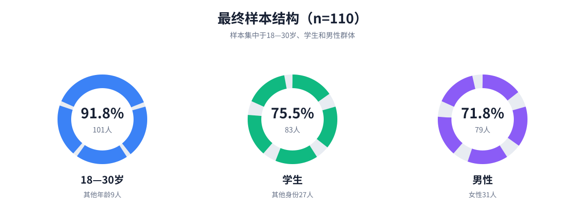

*图1　最终样本的年龄、身份与性别结构。*

## 三、问卷结果分析

### 3.1 使用基础与使用状态（第1—6题）

第1题显示，53人将网易云音乐作为最常用音乐应用，占48.2%；43人仍在使用，但已不是最常用应用，占39.1%；14人已经停止使用，占12.7%。后两组合计57人，已经超过样本的一半。将三组用户的后续回答进行比较，可以观察哪些问题更多地集中在非主力用户和停用用户中。

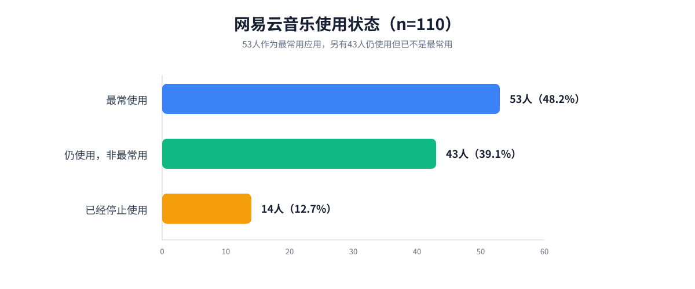

*图2　第1题结果：网易云音乐使用状态。*

第2题中，使用5年以上的用户有55人，使用3—5年的有28人，合计83人，占75.5%，说明样本中的长期用户占多数。第3题显示，每天使用33人，每周使用4—6天26人，每周使用1—3天22人；仍保持每周使用的用户共81人，占73.6%。

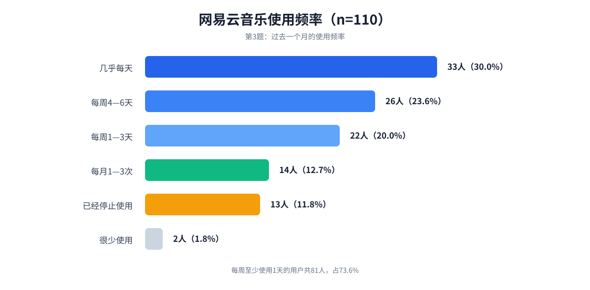

*图3　第3题结果：过去一个月的网易云音乐使用频率。*

第4题中，35人当前为会员，32人曾经购买但会员已经过期，43人从未购买。当前或曾经购买会员的用户共67人，占60.9%，表明多数受访者具有会员付费经历，后面的会员价格与权益评价也会具有较为广泛的样本基础。

第5题显示，受访者最常使用网易云音乐的场景是学习或工作（67人）、独处或休息（64人）和通勤（56人）。在这些高频场景中，卡顿、播放中断和频繁弹窗都会直接打断听歌过程。第6题显示，使用人数最多的功能是搜索歌曲、歌手、专辑或MV（109人），其次是听歌及播放调节（76人）、个人音乐管理（72人）和个性化推荐（64人）。搜索功能几乎覆盖全部样本，播放、音乐管理和推荐也有较高使用量，说明找歌、听歌、整理个人音乐和发现新内容是受访者使用网易云音乐的主要需求。

### 3.2 总体满意度与分项体验（第7—8题）

第7题中，只有四人表示非常满意，45人比较满意，而47人评价一般，14人则不太满意，没有人选择非常不满意。比较满意或非常满意合计49人，占44.5%；评价一般及以下合计61人，占55.5%。整体满意度并未出现大范围否定，但多数用户也没有给出明确的正面评价。

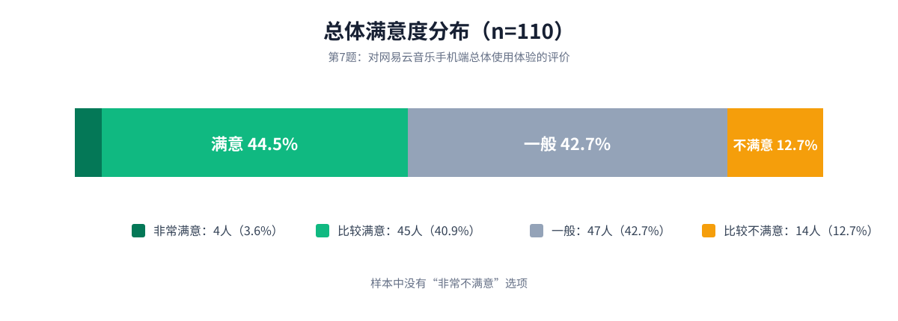

*图4　第7题结果：总体满意度分布。*

第8题的11项体验评分进一步细分了总体评价。歌词准确与同步（4.24分）、播放加载与稳定性（4.09分）、搜索效率（3.87分）和推荐符合偏好程度（3.84分）相对较高；广告与弹窗干扰控制（2.50分）、页面清晰易用程度（2.95分）和会员价格与权益匹配度（3.03分）处于末位。推荐符合偏好的评分达到3.84分，推荐新鲜度与多样性只有3.30分，说明用户对兴趣匹配的评价尚可，对内容重复和探索空间的评价较弱。

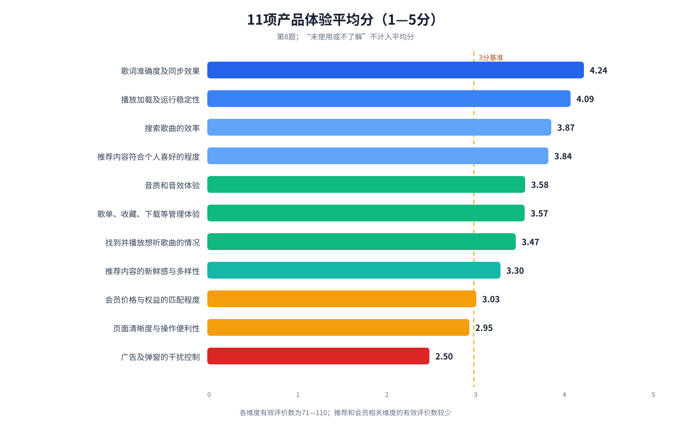

*图5　第8题结果：11项产品体验平均分。*

### 3.3 近期问题及其影响（第9—11题）

第9题中，选择最多的是广告、弹窗和活动提示过多，共51人，占46.4%；其次是页面信息较多或入口难找，共37人，占33.6%。会员价格、权益或规则问题有26人，想听的歌曲无法播放或未找到有25人，推荐内容重复有24人。前两项也与第8题的低分项目一致，广告干扰和页面操作问题同时出现在评分题与问题选择题中。

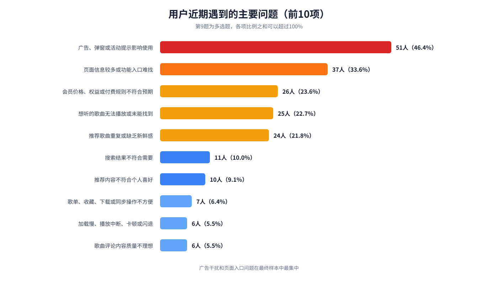

*图6　第9题结果：近期遇到的主要问题。该题为多选题，各项比例之和可以超过100%。*

第10题要求受访者从已遇到的问题中选出影响最大的一项，用于区分“出现过”与“影响最大”。有效回答中，曲库或版权问题有19人，广告干扰16人，页面信息较多或入口难找13人，推荐歌曲重复7人，推荐偏离喜好5人，会员权益和歌单管理各4人。曲库问题在第9题的选择人数不是最高，但在“影响最大”的单选中排在首位。

第11题中，47人表示问题没有造成明显影响；其余63人报告了行为或付费变化，其中20人开始更多使用其他音乐应用，17人减少使用网易云音乐，13人已经停止使用，另有13人的付费或续费受到影响。问题的影响已经从使用感受延伸到竞品迁移、使用频率和会员决策。

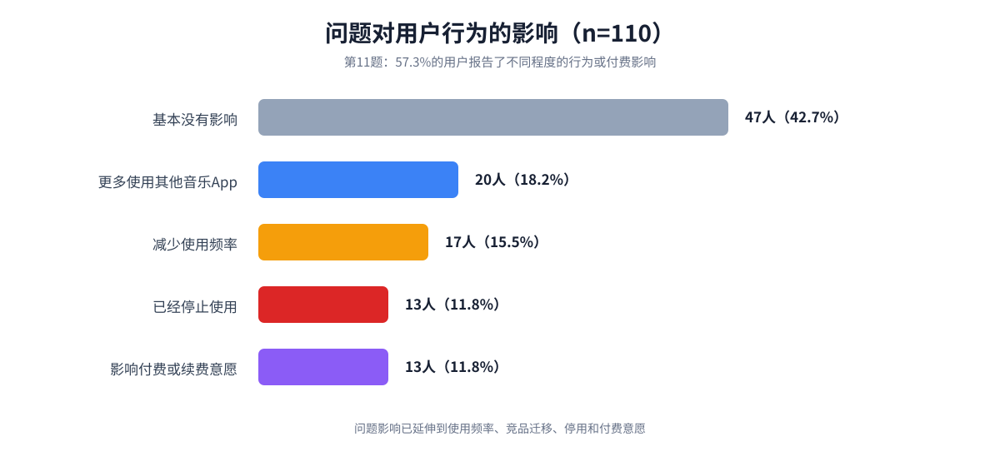

*图7　第11题结果：问题对用户行为或付费的影响。*

### 3.4 关联分析与问题深挖

#### 3.4.1 会员状态对应的是不同的使用阶段

35名当前会员中，32人将网易云音乐作为最常用音乐应用，占91.4%；30人对产品表示满意，占85.7%；34人未来6个月可能或肯定会继续使用，占97.1%；17人同时使用其他音乐应用，占48.6%。

32名会员已过期用户中，只有6人仍将网易云音乐作为最常用音乐应用，占18.8%；满意者同样为6人；30人同时使用其他音乐应用，占93.8%。这组用户的会员权益评分为2.19分，21人选择了会员价格、权益或规则问题，占65.6%。从未开通过会员的43人中，31人选择了广告问题，占72.1%，广告干扰控制平均分为2.02分。

会员状态与使用状态、总体满意度、继续使用意愿和竞品并用均存在显著关联，其中会员状态与使用状态的Cramer's V为0.445，会员状态与竞品并用的Cramer's V为0.402。当前会员、已过期会员和从未开通者表现出清晰分层。已过期会员已经有付费经历，却更少把网易云音乐作为主力应用，也更常同时使用竞品，因此比单纯的“非会员”更值得单独观察。

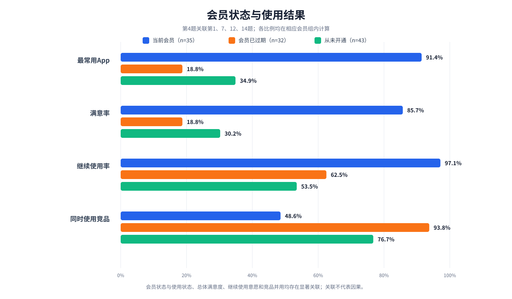

*图8　第4题与第1、7、12、14题的关联。图中比例均在相应会员组内计算。*

#### 3.4.2 广告问题体现了免费体验、会员减免与商业收入之间的张力

广告干扰控制在第8题11项评分中最低，平均2.50分。当前会员、会员已过期和从未开通过会员三组的平均分分别为3.23、2.34和2.02，选择广告问题的比例分别为20.0%、40.6%和72.1%。会员状态与广告评分的组间差异较大（epsilon²=0.389），与是否选择广告问题也存在关联（Cramer's V=0.444）。

这组结果说明，会员减免能够缓冲广告干扰，免费用户则承担了更明显的商业内容负担。另一方面，选择广告问题者的行为变化率为62.7%，未选择者为52.5%，组间差异在FDR校正后没有达到显著水平。广告是最常见、评分最低的问题，但本次样本没有证明它单独构成最直接的流失原因。产品需要控制频次、时机和可关闭性，同时保留合理的收入来源。

#### 3.4.3 曲库问题比页面问题更接近实际行为后果

25名选择曲库问题的受访者中，23人报告了减少使用、转向其他应用、停止使用或付费变化，占92.0%；未选择曲库问题的85人中，这一比例为47.1%。曲库问题与行为变化的Cramer's V为0.381。在主力使用、非主力使用和已经停用三组中，曲库问题的选择率依次为7.5%、30.2%和57.1%，与使用状态的Cramer's V为0.402。

页面信息较多或入口难找被37人选择，占33.6%，但该问题与总体满意度、继续使用意愿和行为变化均未显示显著关联。页面问题影响查找效率，属于普遍的操作摩擦；曲库问题会直接导致用户找不到或听不到目标内容，在本次样本中更接近行为变化。

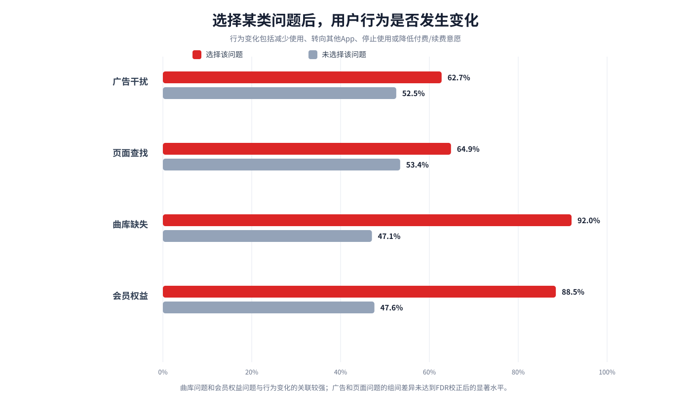

*图9　选择某类问题与未选择该问题的受访者，其行为变化比例对比。*

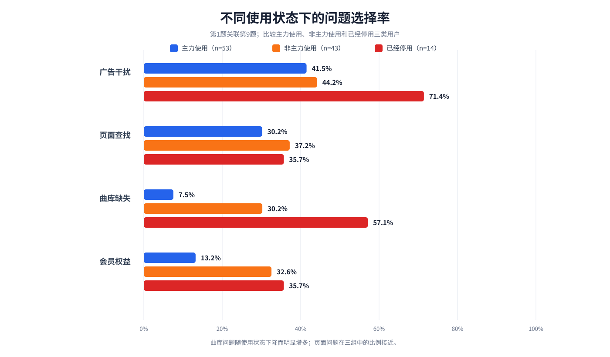

*图10　第1题与第9题的关联。曲库问题随使用状态下降而增多，页面问题在三组中的比例接近。*

#### 3.4.4 推荐重复是高参与用户在持续使用中遇到的问题

64人使用个性化推荐功能，其中24人选择了“推荐歌曲重复或缺乏新鲜感”，占37.5%。这24人全部仍将网易云音乐作为最常用音乐应用。推荐重复问题与较低的行为变化率同时出现，不能解释为“推荐重复会提高留存”，因为没有使用推荐或已经离开的用户缺少遇到该问题的机会。

第8题中，推荐符合偏好平均3.84分，推荐新鲜度与多样性为3.30分；公开正向反馈也肯定了日推、私人漫游和小众音乐发现。推荐问题更适合解释为高参与用户对重复、热门化和控制不足的不满。改进时应保留推荐优势，并增加探索模式、重复控制和负反馈选项。

### 3.5 竞品使用与继续使用意愿（第12—14题）

第12题中，30人只使用网易云音乐，80人同时使用其他音乐应用。较常见的竞品包括QQ音乐（32人）、Spotify（25人）和Apple Music（24人）。其给出的原因则主要集中在曲库或内容更完整、设备及应用生态衔接更方便，以及既有社交关系和使用习惯。竞品并非只在单一功能上分流用户，而是在内容可用性、跨设备体验和长期习惯上形成替代。

第14题中，41人确定会继续使用，36人可能会继续使用，合计77人，占70.0%；18人不确定，15人倾向于不再继续使用。现有用户仍有较强留存基础，但“不确定”和“不继续”人群共33人，其顾虑应需要与第8—11题中的问题结合判断。

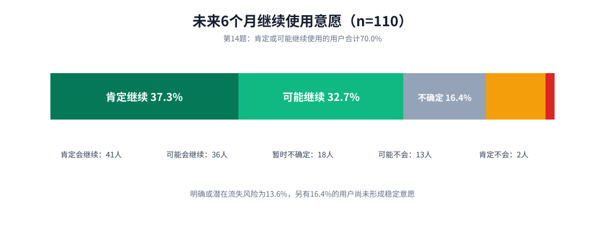

*图11　第14题结果：未来6个月继续使用网易云音乐的意愿。*

### 3.6 优先改进意见与关键词（第15题）

第15题共获得65份实质意见。将回答提取关键词并归类后，出现最多的关键词是歌单与同步（12次），其次是曲库与版权、广告与弹窗（各10次）以及推荐质量（8次）；页面与操作、评论与社区各出现6次。开放题由用户自行表述，因此补充了选择题没有完全展开的细节，例如歌单跨端同步、云盘歌曲管理、评论区治理和会员权益感知。

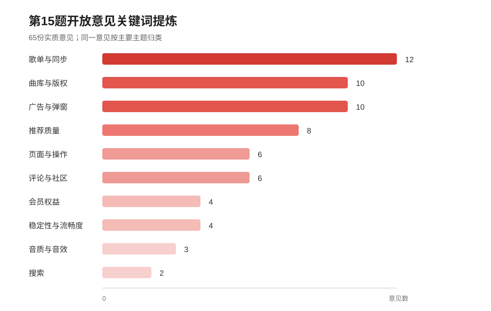

*图12　第15题结果：65份实质意见的关键词提炼。*

## 四、公开用户反馈分析

### 4.1 正向体验

15条正向反馈主要集中在以下方面：

- **推荐与音乐发现：** 日推、私人漫游和发现页歌单能够帮助用户发现新歌和小众歌曲，部分用户认为推荐准确度优于竞品（P05—P09）。
- **评论与内容生态：** 歌曲评论中的故事、用户自建歌单和电台共同形成了具有辨识度的内容生态（P03、P10、P13）。
- **界面与上手体验：** 部分用户认可整体操作逻辑、界面简洁度和学习成本（P01、P02、P11、P12）。
- **曲库补充与细分内容：** 音乐云盘、小众音乐分类和不同曲风的整理具有使用价值（P04、P14）。
- **情感记录：** 听歌记录、好友记录和年度总结能够形成长期使用记忆（P15）。

### 4.2 负向体验

15条负向反馈主要集中在以下方面：

- **歌手与专辑内容组织：** 歌手全部歌曲入口较深，完整歌曲列表难以保存，专辑页混入单曲、节目和改编版本，缺少有效排序与筛选（N01—N04、N07）。
- **曲库与版本质量：** 部分歌曲无法播放，翻唱或替代版本质量不稳定（N05、N12）。
- **推荐与页面体验：** 首页信息变多，推荐内容偏离个人口味，日推中热门短视频歌曲占比过高（N08、N09）。
- **广告与模块控制：** 开屏及返回应用时的广告会中断使用，付费用户也难以隐藏部分非核心模块（N11、N13）。
- **功能细节：** 云盘歌曲加入歌单不够方便，关注歌手后缺少有效管理界面（N03、N06）。
- **音质体验：** 有用户认为最高档音质与竞品相比仍缺乏优势（N14）。
- **社区治理：** 评论区质量下降，“一起听”存在骚扰风险，举报后的处理反馈不及时（N10、N15）。

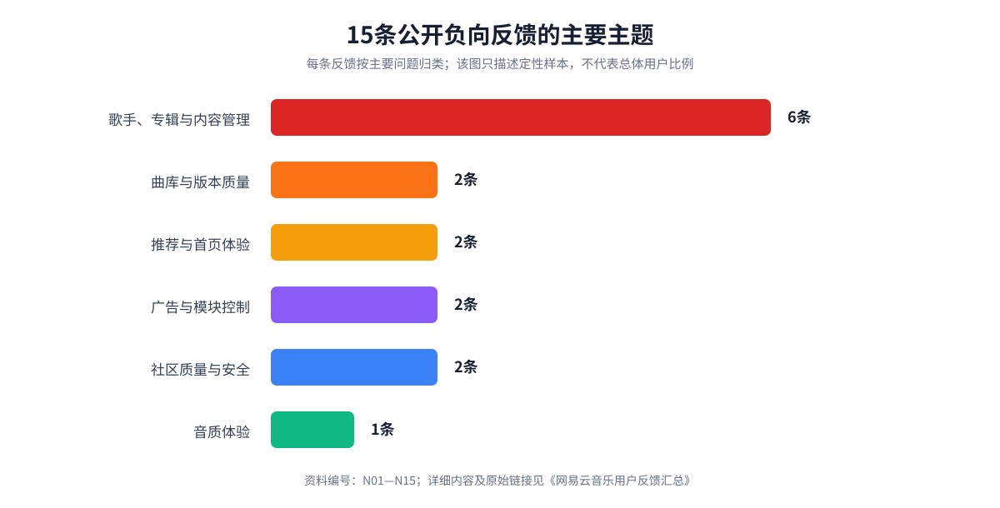

*图13　15条公开负向反馈的主要主题。该图描述的是定性样本构成，不代表总体用户问题发生率。*

## 五、问题分类与优化建议

问卷与公开反馈可以归纳为七类问题。以下各类分别说明问题表现、影响、优化建议和验证指标。

### 5.1 广告与非核心内容干扰

**问题表现**

广告、弹窗和活动提示是第9题中选择人数最多的问题，共51人，占46.4%；广告干扰控制也是第8题评分最低的一项，平均2.50分。公开反馈N11提到开屏和返回应用时的广告会中断听歌，N13则反映部分付费用户仍无法隐藏演出票、云村等非核心模块。

关联分析显示，当前会员、会员已过期和从未开通过会员三组选择广告问题的比例依次为20.0%、40.6%和72.1%。广告承担创收功能，完全取消并不现实；问题在于商业内容是否反复打断核心听歌任务，以及会员减免是否足够清楚。免费体验需要保留完整的找歌和播放流程，会员则应获得可感知的干扰减免。

**优化建议**

1. 对开屏、返回应用和播放过程中的推广设置统一频率上限，避免短时间重复出现。
2. 为付费用户提供清晰的“减少商业内容”权益，并明确哪些页面和广告可以关闭。
3. 增加首页模块管理功能，允许用户隐藏或调整演出票、直播、云村等非核心模块。
4. 设置“专注听歌”模式，只保留搜索、推荐、歌单、播放和个人音乐等核心入口。
5. 区分通知、活动和广告的视觉层级，减少弹窗对当前任务的强制打断。

**验证指标**

广告关闭率、同一用户日均广告触达次数、首页模块隐藏率、启动后退出率、会员满意度及续费意愿。

### 5.2 页面、歌手与专辑查找效率

**问题表现**

问卷反映了页面信息较多和功能入口难找的问题。公开反馈进一步指出：歌手页面缺少清晰的“播放全部”入口；“播放全部”只能处理最新50首歌曲，无法覆盖完整歌曲列表；关注歌手后缺少有效管理；专辑页混入单曲、节目和改编版本；经典专辑缺少筛选与排序（N01—N04、N07）。第9题中有37人选择页面问题，占33.6%，但该问题在主力使用、非主力使用和已经停用三组中的比例接近，也没有显示出与总体满意度或继续使用意愿的显著关联。现有证据更支持将其视为高频效率问题，而不是直接的流失解释。

与此同时，P01、P02、P11和P12说明仍有用户认可产品的操作逻辑与简洁度。正负反馈同时出现，表明不同页面、版本和用户配置下的体验差异较大，优化时应保留已经有效的核心结构，重点处理信息密度和深层入口。

**优化建议**

1. 在歌手页提供稳定可见的“全部歌曲”“热门歌曲”“专辑”和“已关注”入口。
2. 扩大“播放全部”功能的覆盖范围，使其能够处理完整歌曲列表，并明确显示本次包含的歌曲数量。
3. 将正式专辑、单曲、现场版、节目和翻唱内容分层展示。
4. 增加按发行时间、热度、专辑类型和是否可播放进行筛选与排序的功能。
5. 为关注歌手建立集中管理页，提供新歌提醒、取消关注和分组管理。
6. 对首页和“我的”页面开展入口查找测试，优先缩短搜索、歌单、本地音乐、下载和云盘的操作路径。

**验证指标**

核心功能平均点击步数、歌手页到播放的转化率、专辑查找成功率、功能入口搜索次数、任务完成时间及误触率。

### 5.3 推荐重复与兴趣偏移

**问题表现**

推荐系统同时获得了最集中的正面认可和明显的负面反馈。P05—P09认为日推、私人漫游及发现页歌单能够准确贴合兴趣并帮助发现小众歌曲；N08和N09则认为新版首页推荐偏差增大，日推中过多出现热门短视频歌曲。问卷中的推荐评价、推荐重复和开放题意见也反映出类似分化。

64名使用个性化推荐功能的受访者中，24人选择了推荐重复问题，占37.5%，而且这24人全部仍将网易云音乐作为最常用音乐应用。这类投诉发生在持续使用推荐的过程中，不能直接解释为流失。第8题中推荐符合偏好为3.84分，推荐新鲜度与多样性只有3.30分，差距表明改进重点应放在减少重复和增加探索空间，同时保留已有的兴趣匹配能力。

**优化建议**

1. 将兴趣匹配度、内容新鲜度和重复控制同时纳入推荐排序目标。
2. 为日推提供“熟悉”“探索”“小众”“按当前情绪”等可切换模式。
3. 增加“不喜欢的原因”选项，如听腻了、不喜欢该风格、短视频热门过多、版本不合适。
4. 对近期跳过、明确不喜欢和连续重复出现的歌曲设置更长的降权周期。
5. 在推荐卡片中说明推荐依据，帮助用户理解并调整兴趣标签。
6. 保留日推、私人漫游和小众音乐发现的产品特色，避免统一改成以热门内容为主的推荐逻辑。

**验证指标**

推荐歌曲重复率、推荐播放完成率、连续跳过率、“不感兴趣”触发率、收藏率、推荐模式使用率及推荐满意度。

### 5.4 曲库、版权与歌曲版本

**问题表现**

问卷中“想听的歌曲无法播放或未能找到”属于直接影响核心需求的问题。公开反馈N05指出曲库和版权不足，N12指出部分歌曲只能找到质量不理想的版本。P04和P14说明云盘及小众音乐分类能够部分补充平台内容，具有保留价值。

曲库问题在第9题中有25人选择，在第10题“影响最大”的有效回答中有19人选择，排在首位。选择曲库问题者的行为变化率为92.0%，未选择者为47.1%；该问题在主力使用、非主力使用和已经停用三组中的比例分别为7.5%、30.2%和57.1%。当用户已经明确想听某首歌时，无法播放、未能找到或默认版本不合适会阻断整个听歌任务，因此曲库可用性比一般操作不便更接近竞品迁移和停止使用。

**优化建议**

1. 对不可播放歌曲明确展示版权状态、预计恢复信息和可用替代版本。
2. 在搜索结果中优先区分原唱、翻唱、现场版、伴奏和剪辑版本。
3. 提供“版权恢复提醒”和“一键寻找同专辑可播放版本”。
4. 持续补充高需求版权，并将搜索无结果次数作为版权采购依据。
5. 优化云盘歌曲与平台歌曲的匹配、重命名、封面和歌单添加流程。
6. 保留小众音乐和细分曲风分类，防止曲库扩充后内容发现完全向热门歌曲集中。

**验证指标**

搜索无结果率、不可播放歌曲点击率、搜索后转出率、版权恢复提醒订阅量、版本误播反馈量及云盘歌曲加入歌单成功率。

### 5.5 播放稳定性、音质与个人音乐管理

**问题表现**

问卷覆盖了加载、播放中断、卡顿、闪退、音质、歌词、下载、本地音乐、云盘和歌单管理等体验。公开反馈N06反映云盘歌曲加入歌单不方便，N14反映部分用户认为最高档音质缺少竞争优势。P04则肯定了音乐云盘补充平台资源的价值。

稳定播放属于基础体验，云盘、歌单和音质属于长期用户及付费用户更容易感知的进阶体验。基础稳定性问题应优先修复；音质和管理能力可以通过更明确的设置与流程优化提升感知价值。

**优化建议**

1. 按网络环境、设备型号和播放来源建立卡顿、失败及闪退监控。
2. 对网络波动提供平滑降码率和断点恢复，减少整首重新加载。
3. 在音质设置中展示编码、码率、设备支持情况和实际生效状态。
4. 简化云盘歌曲加入歌单的步骤，支持批量添加、匹配纠错和元数据编辑。
5. 统一“我喜欢”、最近播放、下载、本地音乐和云盘中的批量管理方式。

**验证指标**

播放失败率、卡顿率、闪退率、首帧播放时间、音质切换成功率、云盘任务完成率及个人音乐批量操作时长。

### 5.6 评论区、内容生态与社交安全

**问题表现**

P03、P10和P13表明，歌曲评论、用户故事、自建歌单和电台共同构成了网易云音乐具有辨识度的内容生态。N10反映评论区质量下降，N15反映“一起听”场景存在言语骚扰风险，举报后迟迟未获得处理结果。

社区内容能够延长用户停留并形成情感连接，治理不足也会迅速损害信任。骚扰和举报处理属于用户安全问题，即使公开反馈中的出现数量不多，也需要单独处理。

**优化建议**

1. 对评论区营销、复制刷屏、攻击性表达和低质量重复内容加强识别与降权。
2. 为用户提供评论排序偏好，包括高质量、最新、关注用户和仅看有互动内容。
3. 在“一起听”等陌生人社交场景中默认提供快速屏蔽、静音、退出和举报入口。
4. 举报后向用户反馈受理、审核和处理结果，并设定高风险举报的处理时限。
5. 对被多次举报的账号限制陌生人匹配、私信或语音权限。
6. 保留优质评论、歌曲故事和用户歌单的展示空间，避免治理过程中削弱社区内容本身。

**验证指标**

骚扰举报量、重复举报率、平均处理时间、处理结果反馈率、评论区有效互动率、屏蔽率及社交功能次日留存率。

### 5.7 会员权益与价值表达

**问题表现**

问卷中的会员权益评价及N13反映，部分用户购买较高等级会员后，仍会受到广告或非核心模块干扰。32名会员已过期用户的会员权益平均分为2.19分，其中21人选择了会员价格、权益或规则问题，占65.6%；30人同时使用其他音乐应用，占93.8%。当前会员的权益评分为3.80分，只有4人选择会员问题。会员价值感与用户所处的会员阶段同时变化，已过期会员是理解续费障碍和竞品迁移的重要群体。

**优化建议**

1. 用清晰对照表说明不同会员等级的曲库、音质、广告和功能权益。
2. 将“降低广告干扰”和“自定义非核心模块”纳入高等级会员的明确权益。
3. 在购买前提示具体歌曲、音质和设备是否适用，降低购买后的预期落差。
4. 精简重复或边界模糊的会员等级，减少用户理解成本。
5. 建立会员权益未生效的快速检测与客服入口。

**验证指标**

会员权益咨询量、购买后退款率、权益未生效投诉量、会员满意度、续费率及高等级会员功能使用率。

## 六、结论

问卷中出现次数最多的问题是广告干扰和页面查找，分项评分最低的也正是广告控制与页面易用性。关联分析进一步区分了问题性质：广告和页面主要表现为高频体验摩擦；曲库缺失和会员权益问题与行为变化的关系更强，尤其集中在非主力用户、停用用户和会员已过期用户中。

产品改进可以围绕四类任务展开。第一，控制广告和非核心模块的频次、时机与可关闭性，处理商业收入与听歌连续性之间的冲突。第二，提高曲库与歌曲版本的可用性，并缩短歌手、专辑和个人音乐的查找路径。第三，在保留推荐准确度的基础上，增加探索模式、重复控制和用户反馈入口。第四，明确会员权益并改善社区举报、骚扰处理和结果反馈。

公开反馈同时表明，日推、评论、用户歌单、音乐云盘、小众音乐分类和听歌记录仍然具有辨识度。改进的目标是减少打断、补足内容可用性并增加用户控制，同时保留这些已经形成使用习惯和情感价值的能力。

## 七、研究局限性

本次调查采用便利抽样和转发扩散方式。最终样本中，18—30岁用户、学生和男性占比较高，家庭转发渠道还带来了部分银行、金融及相关职业样本，因此样本结构不能代表网易云音乐全部用户。

问卷设计也存在顺序问题。第7题先询问总体满意度，第8题再评价11项具体体验，可能使前面的总体判断影响后续评分。第9—11题讨论问题及其影响，第12—14题转向竞品和继续使用意愿，第15题又回到优先改进方向，主题切换较多；第10题与第15题虽然形式不同，也可能让填写者产生重复感。

公开反馈采用15条正向、15条负向的定性样本，用于补充问题场景和具体表现。该数量是研究设计中的平衡取样，不能据此计算各类问题在全部用户中的发生率。报告依据受访者自述和公开评论进行判断，没有接入实际播放日志、点击路径、会员续费记录或举报处理数据，因此优化建议仍需通过产品数据和后续测试验证。

## 附录

### 附录A：调查问卷原文

**网易云音乐手机端用户体验调查问卷**

您好！本问卷旨在了解用户对网易云音乐手机App的使用情况、体验评价及产品问题。问卷采用匿名形式，预计需要3—5分钟。请根据最近6个月或最近一次使用网易云音乐的实际体验作答。

**1. 您目前使用网易云音乐手机App的情况是？［单选题］**

- 目前最常使用的音乐App
- 目前仍在使用，但不是最常用的音乐App
- 曾经使用，现在已经不用
- 从未使用过（请跳至问卷末尾，提交答卷）

**2. 您使用网易云音乐多长时间？［单选题］**

- 不满6个月
- 6个月—1年
- 1—3年
- 3—5年
- 5年以上

**3. 您目前使用网易云音乐的频率是？［单选题］**

- 几乎每天
- 每周4—6天
- 每周1—3天
- 每月1—3次
- 很少使用
- 已经停止使用

**4. 您目前的会员状态是？［单选题］**

- 当前拥有会员权益
- 曾经开通过，目前已到期
- 从未开通过
- 不清楚

**5. 您通常在什么场景使用网易云音乐？［多选题］**

- 通勤或出行
- 学习或工作
- 运动
- 放松心情
- 睡前或助眠
- 聚会或与他人分享音乐
- 主动寻找新音乐
- 其他

**6. 您主要使用网易云音乐的哪些功能？［多选题］**

- 搜索歌曲、歌手、专辑或MV等内容
- 使用个性化推荐发现音乐，如每日推荐、私人DJ、漫游、心动模式、相似歌曲
- 浏览排行榜、官方歌单或用户歌单
- 创建、收藏、导入和管理歌单
- 管理个人音乐，如“我喜欢”、最近播放、下载及本地音乐
- 使用听歌识曲
- 查看歌词、翻译、音乐百科等歌曲信息
- 使用黑胶播放器、皮肤、歌词动效等个性化功能
- 查看或发表歌曲评论
- 分享歌曲或使用“一起听”
- 浏览关注的音乐人或其他用户发布的笔记、动态
- 收听播客、有声剧等声音内容
- 其他

**7. 总体而言，您对网易云音乐手机端的满意程度是？［单选题］**

- 非常不满意
- 比较不满意
- 一般
- 比较满意
- 非常满意

**8. 请评价网易云音乐在以下方面的表现。［矩阵单选题］**

评价选项：很差、较差、一般、较好、很好、未使用或不了解。

- 找到并播放想听歌曲的情况
- 搜索歌曲的效率
- 推荐内容符合个人喜好的程度
- 推荐内容的新鲜感与多样性
- 播放加载及运行稳定性
- 音质和音效体验
- 歌词准确度及同步效果
- 歌单、收藏、下载等管理体验
- 页面清晰度与操作便利性
- 广告及弹窗的干扰控制
- 会员价格与权益的匹配程度

**9. 最近使用过程中，您遇到过哪些问题？［多选题］**

- 想听的歌曲无法播放或未能找到
- 搜索结果不符合需要
- 推荐内容不符合个人喜好
- 推荐歌曲重复或缺乏新鲜感
- 加载慢、播放中断、卡顿或闪退
- 音质、音效或歌词体验不理想
- 歌单、收藏、下载或同步操作不方便
- 页面信息较多或功能入口难找
- 广告、弹窗或活动提示影响使用
- 会员价格、权益或付费规则不符合预期
- 歌曲评论内容质量不理想
- 客服或问题反馈处理不理想
- 其他
- 没有遇到明显问题（选择任一选项请跳至第11题）

**10. 上述问题中，对您使用体验影响最大的是哪一个？（若上一题只选一个本题可不填）［单选题］**

- 想听的歌曲无法播放或未能找到
- 搜索结果不符合需要
- 推荐内容不符合个人喜好
- 推荐歌曲重复或缺乏新鲜感
- 加载慢、播放中断、卡顿或闪退
- 音质、音效或歌词体验不理想
- 歌单、收藏、下载或同步操作不方便
- 页面信息较多或功能入口难找
- 广告、弹窗或活动提示影响使用
- 会员价格、权益或付费规则不符合预期
- 歌曲评论内容质量不理想
- 客服或问题反馈处理不理想
- 其他

**11. 该问题对您的使用产生了什么影响？［单选题］**

- 基本没有影响
- 减少了使用频率
- 更多使用其他音乐App
- 降低了付费或续费意愿
- 已经停止使用
- 其他

**12. 除网易云音乐外，过去3个月您还使用过哪些在线音乐App？［多选题］**

- QQ音乐
- 酷狗音乐
- 酷我音乐
- 汽水音乐
- 咪咕音乐
- 波点音乐
- Apple Music
- Spotify
- 其他
- 只使用网易云音乐（选择任一选项请跳至第14题）

**13. 您使用其他音乐App的主要原因是什么？［多选题］**

- 能听到更多想听的歌曲
- 推荐内容更符合个人喜好
- 搜索和播放更加方便
- 播放稳定性或音质体验更好
- 页面更加简洁清晰
- 广告及弹窗干扰更少
- 会员价格或免费体验更合适
- 与手机或其他常用App衔接方便
- 其他

**14. 未来6个月，您继续使用网易云音乐的意愿是？［单选题］**

- 肯定不会继续使用
- 可能不会继续使用
- 暂时不确定
- 可能会继续使用
- 肯定会继续使用

**15. 如果只能优先改进一项，您最希望网易云音乐改进什么？［填空题］**

**16. 您的年龄段是？［单选题］**

- 17岁及以下
- 18—22岁
- 23—30岁
- 31—40岁
- 41—50岁
- 51岁及以上

**17. 您目前的职业或身份是？［单选题］**

- 中学生
- 大专或本科在校生
- 研究生
- 企业或公司职员
- 机关或事业单位工作人员
- 个体经营者或自由职业者
- 待业或暂无固定职业
- 退休人员
- 其他

**18. 您的性别是？［单选题］**

- 男
- 女
- 其他
- 不便透露

**19. 您使用的手机系统是？［单选题］**

- iOS
- Android
- HarmonyOS
- 其他
- 不清楚

### 附录B：用户反馈原文

#### 正向反馈

- **P01：** 整体操作比较顺手，比Spotify更容易理解。来源：[LINUX DO](https://linux.do/t/topic/2582948?tl=en)
- **P02：** 关闭非必要页面后界面较清爽，交互和简洁度优于QQ音乐。来源：[LINUX DO](https://linux.do/t/topic/2582948?tl=en)
- **P03：** 歌曲评论区里的故事很有趣，能增强听歌体验。来源：[LINUX DO](https://linux.do/t/topic/2582948?tl=en)
- **P04：** 音乐云盘可以补充平台资源，资源使用范围较丰富。来源：[LINUX DO](https://linux.do/t/topic/2582948?tl=en)
- **P05：** 推荐新歌的效果比酷狗好，适合用来发现歌曲。来源：[LINUX DO](https://linux.do/t/topic/2582948?tl=en)
- **P06：** 日推、私人漫游和发现页歌单推荐具有较高使用价值。来源：[LINUX DO](https://linux.do/t/topic/2582948?tl=en)
- **P07：** 听歌推荐比较准确，能贴合个人口味。来源：[乐游网用户留言](https://m.962.net/y/258219)
- **P08：** 推荐中经常能发现小众歌曲。来源：[乐游网用户留言](https://m.962.net/y/258219)
- **P09：** 每日推荐具有明显的平台特色。来源：[乐游网用户留言](https://m.962.net/y/258219)
- **P10：** 评论区氛围优于其他音乐软件。来源：[乐游网用户留言](https://m.962.net/y/258219)
- **P11：** 界面简洁，新用户也容易上手。来源：[乐游网用户留言](https://m.962.net/y/258219)
- **P12：** 设计简约但不单调，整体体验舒适。来源：[App Store评论](https://apps.apple.com/cn/app/%E7%BD%91%E6%98%93%E4%BA%91%E9%9F%B3%E4%B9%90-%E6%95%B0%E4%BA%BF%E9%9F%B3%E4%B9%90%E7%95%85%E5%90%AC/id590338362?l=en-GB&see-all=reviews&platform=iphone)
- **P13：** 电台、用户自建歌单和评论共同形成了有特色的内容生态。来源：[App Store评论](https://apps.apple.com/cn/app/%E7%BD%91%E6%98%93%E4%BA%91%E9%9F%B3%E4%B9%90-%E6%95%B0%E4%BA%BF%E9%9F%B3%E4%B9%90%E7%95%85%E5%90%AC/id590338362?l=en-GB&see-all=reviews&platform=iphone)
- **P14：** 小众音乐类型较丰富，对不同曲风的分类整理也很细致。来源：[App Store评论](https://apps.apple.com/cn/app/%E7%BD%91%E6%98%93%E4%BA%91%E9%9F%B3%E4%B9%90-%E6%95%B0%E4%BA%BF%E9%9F%B3%E4%B9%90%E7%95%85%E5%90%AC/id590338362?l=en-GB&see-all=reviews&platform=iphone)
- **P15：** 听歌记录、好友记录和年度总结兼具实用性与情感价值。来源：[AppFollow收录评论](https://apps.appfollow.io/ios/wang-yi-yun-yin-le-1-8yi-nei-rong-chang-ting/590338362?country=cn)

#### 负向反馈

- **N01：** 歌手页面无法直接播放该歌手的全部歌曲，入口位置也较深。来源：[LINUX DO](https://linux.do/t/topic/2582948?tl=en)
- **N02：** “播放全部”只能处理最新50首，无法一键保存完整歌曲列表。来源：[LINUX DO](https://linux.do/t/topic/2582948?tl=en)
- **N03：** 关注歌手后缺少有效的关注管理界面。来源：[LINUX DO](https://linux.do/t/topic/2582948?tl=en)
- **N04：** 歌手专辑页混入单曲、节目和改编版本，旧专辑难以查找。来源：[LINUX DO](https://linux.do/t/topic/2582948?tl=en)
- **N05：** 歌曲版权和曲库不足，许多想听的歌曲无法播放。来源：[LINUX DO](https://linux.do/t/topic/2582948?tl=en)
- **N06：** 将云盘歌曲加入歌单的操作不方便。来源：[LINUX DO](https://linux.do/t/topic/2582948?tl=en)
- **N07：** 专辑缺少筛选和排序功能，经典作品不容易找到。来源：[LINUX DO](https://linux.do/t/topic/2582948?tl=en)
- **N08：** 新版页面越来越杂乱，首页推荐与个人口味偏差较大。来源：[乐游网用户留言](https://m.962.net/y/258219)
- **N09：** 日推中出现过多热门短视频歌曲，个性化程度下降。来源：[乐游网用户留言](https://m.962.net/y/258219)
- **N10：** 评论区质量下降，原有的社区氛围有所减弱。来源：[乐游网用户留言](https://m.962.net/y/258219)
- **N11：** 广告数量较多，开屏和返回App时的广告干扰听歌。来源：[App Store评论](https://apps.apple.com/cn/app/%E7%BD%91%E6%98%93%E4%BA%91%E9%9F%B3%E4%B9%90-%E6%95%B0%E4%BA%BF%E9%9F%B3%E4%B9%90%E7%95%85%E5%90%AC/id590338362?l=en-GB&see-all=reviews&platform=iphone)、[乐游网用户留言](https://m.962.net/y/258219)
- **N12：** 部分歌曲只有不理想的版本，翻唱资源较多且质量参差。来源：[App Store评论](https://apps.apple.com/cn/app/%E7%BD%91%E6%98%93%E4%BA%91%E9%9F%B3%E4%B9%90-%E6%95%B0%E4%BA%BF%E9%9F%B3%E4%B9%90%E7%95%85%E5%90%AC/id590338362?l=en-GB&see-all=reviews&platform=iphone)
- **N13：** 购买SVIP后仍不能自由隐藏演出票、云村等非核心模块。来源：[App Store评论](https://apps.apple.com/cn/app/%E7%BD%91%E6%98%93%E4%BA%91%E9%9F%B3%E4%B9%90-%E6%95%B0%E4%BA%BF%E9%9F%B3%E4%B9%90%E7%95%85%E5%90%AC/id590338362?l=en-GB&see-all=reviews&platform=iphone)
- **N14：** 用户认为最高档音质仍弱于部分竞品的普通高音质。来源：[App Store评论](https://apps.apple.com/cn/app/%E7%BD%91%E6%98%93%E4%BA%91%E9%9F%B3%E4%B9%90-%E6%95%B0%E4%BA%BF%E9%9F%B3%E4%B9%90%E7%95%85%E5%90%AC/id590338362?l=en-GB&see-all=reviews&platform=iphone)
- **N15：** “一起听”存在言语骚扰风险，用户举报后迟迟未获得处理结果。来源：[App Store评论](https://apps.apple.com/cn/app/%E7%BD%91%E6%98%93%E4%BA%91%E9%9F%B3%E4%B9%90-%E6%95%B0%E4%BA%BF%E9%9F%B3%E4%B9%90%E7%95%85%E5%90%AC/id590338362?l=en-GB&see-all=reviews&platform=iphone)
