# 网易云音乐手机端用户问题分类与优化建议报告

**报告日期：** 2026年11月1日  
**研究对象：** 网易云音乐手机端  
**研究材料：** 110份最终保留问卷、30条公开用户反馈、作品及界面操作记录、竞品官方资料  
**设计范围：** 歌手作品完整浏览、听歌流程推广干扰控制、评论及陌生互动举报反馈

## 一、研究目的与方法

本报告识别用户在找歌、听歌和音乐互动中的主要任务及体验问题，结合公开反馈与实际场景核对形成需求，并参考竞品机制确定设计范围。分析结果落实到作品关联、推广控制和举报反馈三项需求的业务规则、交互流程与验收要求。

### 1.1 研究材料

问卷共19题，覆盖使用状态、使用时长与频率、会员状态、使用场景、主要功能、满意度、体验评价、问题及影响、竞品使用、继续使用意愿、改进意见和人口信息。问卷回收159份，最终保留110份用于分析；开放题中65份包含实质改进意见。

30条公开反馈包括正向15条、负向15条，来源为LINUX DO、乐游网用户留言、App Store及AppFollow。它们用于补充具体场景、理解正负体验及识别问卷未充分覆盖的问题，条目编号与附录B一致。

作品发行资料、平台检索及2026-11-01界面操作记录用于核对当前能力和具体缺口，界面记录环境为网易云音乐iOS 9.6.15。竞品官方帮助、隐私指引和广告规格用于比较解决机制；界面判断限于记录所覆盖的版本、账号和场景，竞品能力按官方资料注明的产品及地区范围解释。

### 1.2 分析过程与交付

问卷与公开反馈识别使用任务和问题主题；场景核对明确问题发生条件及已有能力；需求分析评估用户价值、证据和实施依赖；竞品比较提供机制参照；PRD定义三项方案的范围、流程、规则和验收。

| 环节 | 核心问题 | 分析产出 | 对应材料 |
|---|---|---|---|
| 问卷及公开反馈 | 用户常做什么、遇到什么问题、评价如何 | 主要任务、问题选择、体验差异与具体反馈 | 本报告第2—4章、问卷原稿及分析工作簿 |
| 需求分析 | 问题是否成立、改善什么、如何取舍 | 七类问题、12个需求组与三项设计范围 | [需求分析](requirements-analysis.md) |
| 竞品比较 | 相关任务有哪些可借鉴机制与局限 | 作品关系、推广控制和举报查询的对比 | [竞品分析报告](competitive-analysis.md) |
| 方案与PRD | 用户如何完成任务、系统遵循什么规则 | 功能、状态、流程、异常及验收标准 | [产品需求文档](prd.md) |

### 1.3 统计与解释口径

选择题按110份最终保留样本统计，多选题比例之和可以超过100%；体验评分采用5分制，“未使用或不了解”不计入均值；开放题主题统计表示被提及次数。关联分析采用3,000次置换检验，分类变量报告Cramer's V，组间评分差异报告Kruskal–Wallis效应量η²_H，采用max(0, (H−k+1)/(n−k))计算，其中H为Kruskal–Wallis统计量、n为该项有效评分数、k为分组数；以Benjamini—Hochberg方法对34项检验进行FDR校正。效应量定义参照[rstatix官方文档](https://rpkgs.datanovia.com/rstatix/reference/kruskal_effsize.html)。

完整交叉表、检验结果和110行分析数据见关联与深度分析工作簿（逐行数据仅在本地保留）。关联用于描述本次样本中变量的共现，具体因果与方案效果通过后续验证判断。

## 二、样本构成

原始问卷共159份，8份因硬性质控问题排除，另41份经进一步筛选未纳入，最终保留110份用于分析。最终样本中，18—30岁用户101人，占91.8%；学生83人，占75.5%；男性79人，女性31人。样本集中在年轻学生和男性，与问卷主要通过同龄学生关系网络及家庭转发渠道收集有关；家庭转发也带来了部分银行、金融及相关职业样本。

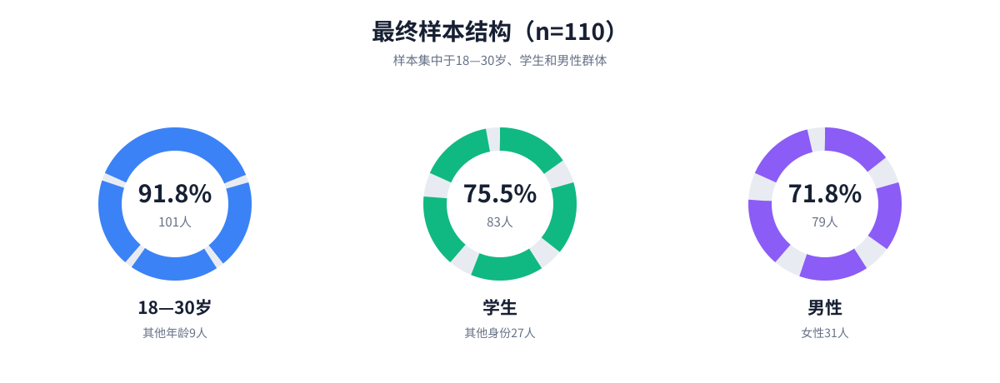

*图1　最终样本的年龄、身份与性别结构。*

## 三、问卷结果分析

### 3.1 使用基础与使用状态（第1—6题）

第1题显示，53人将网易云音乐作为最常用音乐应用，占48.2%；43人仍在使用，但不是最常用应用，占39.1%；14人已经停止使用，占12.7%。后两组合计57人，已经超过样本的一半。将三组用户的后续回答进行比较，可以观察哪些问题更多地集中在非主力用户和停用用户中。

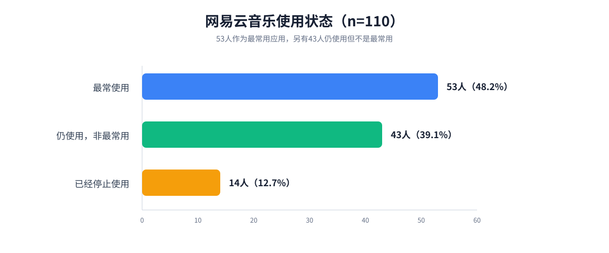

*图2　第1题结果：网易云音乐使用状态。*

第2题中，使用5年以上的用户有55人，使用3—5年的有28人，合计83人，占75.5%，说明样本中的长期用户占多数。第3题显示，几乎每天使用33人，每周使用4—6天22人，每周使用1—3天26人；仍保持每周使用的用户共81人，占73.6%。

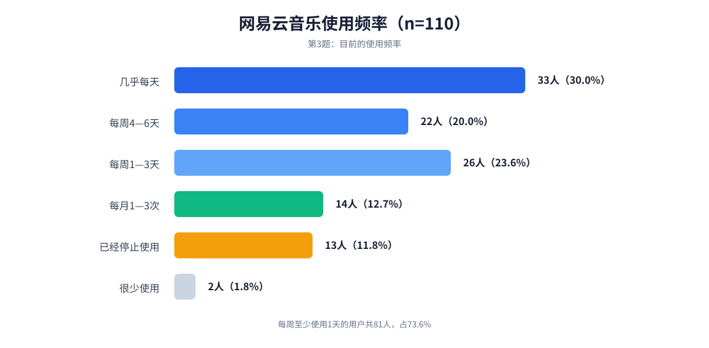

*图3　第3题结果：目前的网易云音乐使用频率。*

第4题中，35人当前为会员，32人曾经购买但会员已经过期，43人从未购买。具有会员付费经历的受访者共67人，占60.9%。

第5题中，较常见的使用场景是学习或工作（67人）、放松心情（64人）和通勤或出行（56人）。这些场景需要关注任务接续、信息查看和操作便利性。

第6题中，搜索有109人选择，查看歌词、翻译等歌曲信息有96人选择，个人音乐管理和个性化推荐分别有72人、64人选择。与后续任务分析相关的功能如下；本题为多选题。

| 功能 | 人数 | 占110份样本比例 | 对需求分析的作用 |
|---|---:|---:|---|
| 搜索歌曲、歌手、专辑或MV | 109 | 99.1% | 保障主动查找及后续作品浏览路径 |
| 查看歌词、翻译、音乐百科等信息 | 96 | 87.3% | 将音乐信息可见性纳入听歌体验评价 |
| 管理个人音乐 | 72 | 65.5% | 保障个人音乐入口和既有使用路径 |
| 个性化推荐 | 64 | 58.2% | 保留发现价值，并提供偏好控制 |
| 查看或发表歌曲评论 | 43 | 39.1% | 为评论区任务与内容控制提供使用背景 |
| 分享歌曲或使用一起听 | 21 | 19.1% | 提供互动背景，具体互动方式需分别核对 |
| 听歌识曲 | 15 | 13.6% | 核对有即时需求时的入口发现与采集启动 |

搜索、信息查看、个人音乐和推荐共同构成主要任务。评价推广干扰时，需要同时观察音频播放、信息可见和操作完成。评论及互动的使用人数用于说明任务背景，具体举报处理缺口由案例及操作记录核对。

### 3.2 总体满意度与分项体验（第7—8题）

第7题中，4人表示非常满意，45人比较满意，47人评价一般，14人比较不满意，无人选择非常不满意。比较满意或非常满意合计49人，占44.5%；评价一般及以下合计61人，占55.5%。样本评价主要集中在“一般”和“比较满意”，具体改善方向需结合分项评分与使用问题判断。

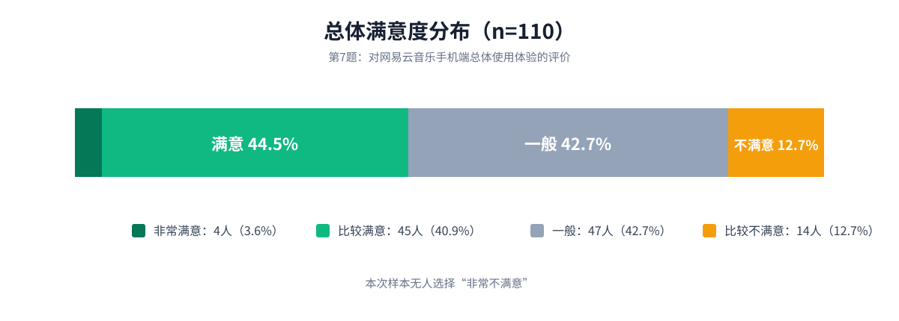

*图4　第7题结果：总体满意度分布。*

第8题的11项体验评分进一步细分了总体评价。歌词准确与同步（4.24分）、播放加载与稳定性（4.09分）、搜索效率（3.87分）和推荐符合偏好程度（3.84分）相对较高；广告与弹窗干扰控制（2.50分）、页面清晰易用程度（2.95分）和会员价格与权益匹配度（3.03分）处于末位。推荐符合偏好的评分达到3.84分，推荐新鲜度与多样性只有3.30分，说明用户对兴趣匹配的评价尚可，对内容重复和探索空间的评价较弱。

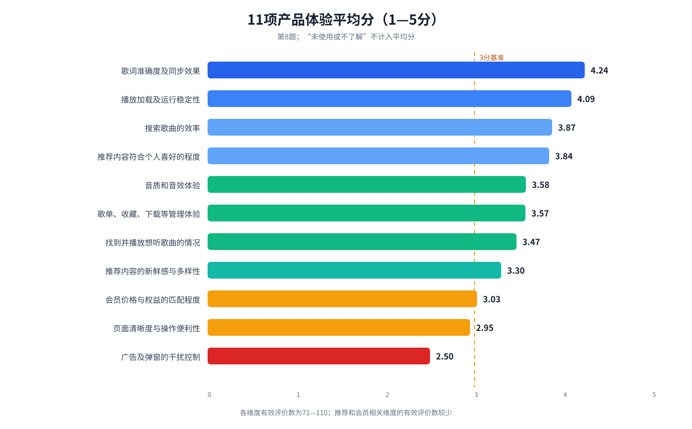

*图5　第8题结果：11项产品体验平均分。*

### 3.3 近期问题及其影响（第9—11题）

第9题中，选择最多的是“广告、弹窗或活动提示影响使用”，共51人，占46.4%；其次是页面信息较多或入口难找，共37人，占33.6%。会员价格、权益或规则问题有26人，想听的歌曲无法播放或未找到有25人，推荐内容重复有24人。前两项也与第8题的低分项目一致，广告干扰和页面操作问题同时出现在评分题与问题选择题中。

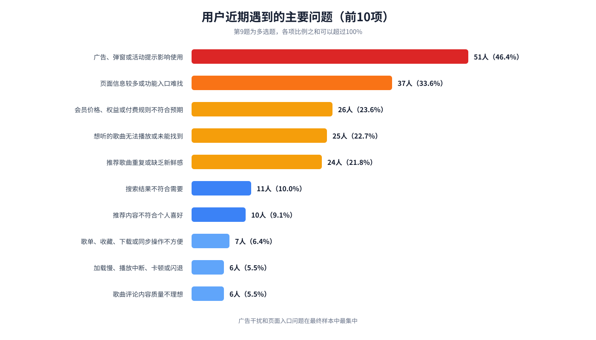

*图6　第9题结果：近期遇到的主要问题。该题为多选题，各项比例之和可以超过100%。*

第10题询问影响最大的问题，允许第9题只选一项者不填写。以下人数按本题有明确选择的回答统计：想听的歌曲无法播放或未找到有19人，广告干扰16人，页面信息较多或入口难找13人，推荐歌曲重复7人，推荐偏离喜好5人，会员权益和歌单管理各4人。歌曲可用性问题在第9题的选择人数不是最高，但在“影响最大”的单选中排在首位。

第11题中，47人表示问题没有造成明显影响；其余63人报告了使用行为或付费意愿变化，其中20人开始更多使用其他音乐应用，17人减少使用网易云音乐，13人已经停止使用，另有13人选择“降低了付费或续费意愿”。上述结果为受访者自报，具体原因及实际行为需结合个案和行为记录核对。

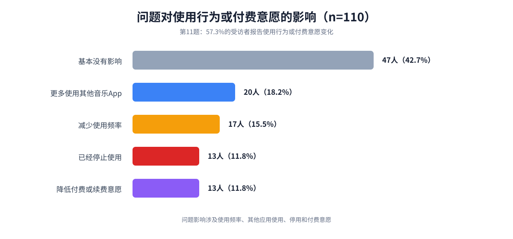

*图7　第11题结果：问题对使用行为或付费意愿的影响。*

### 3.4 关联分析与问题深挖

#### 3.4.1 不同会员状态用户的使用与评价差异

35名当前会员中，32人将网易云音乐作为最常用音乐应用，占91.4%；30人对产品表示满意，占85.7%；34人未来6个月可能或肯定会继续使用，占97.1%；17人在过去3个月使用过其他音乐应用，占48.6%。

32名会员已过期用户中，只有6人仍将网易云音乐作为最常用音乐应用，占18.8%；满意者同样为6人；30人在过去3个月使用过其他音乐应用，占93.8%。这组用户的会员权益评分为2.19分，21人选择了会员价格、权益或规则问题，占65.6%。从未开通过会员的43人中，31人选择了广告问题，占72.1%，广告干扰控制平均分为2.02分。

会员状态与使用状态、总体满意度、继续使用意愿及过去3个月使用其他音乐应用的情况均存在显著关联。其中，会员状态与使用状态的Cramer's V为0.445，与过去3个月使用其他应用情况的Cramer's V为0.402。已过期会员具有付费经历，当前将本品作为主力的比例较低，适合与从未开通会员者分组观察。

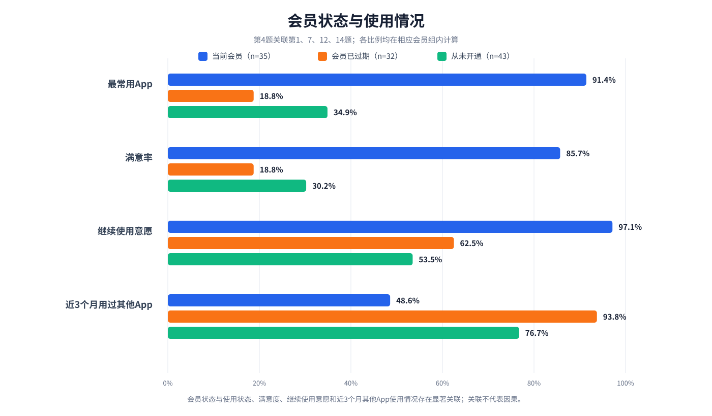

*图8　第4题与第1、7、12、14题的关联，各比例均在相应会员组内计算。其他应用使用为过去3个月的使用经历；继续使用意愿为未来6个月选择可能或肯定继续使用的比例。*

#### 3.4.2 会员状态与广告感知存在差异

广告干扰控制在第8题11项评分中最低，平均2.50分。当前会员、会员已过期和从未开通过会员三组的平均分分别为3.23、2.34和2.02，选择广告问题的比例分别为20.0%、40.6%和72.1%。会员状态与广告评分的组间差异较大（η²_H=0.389），与是否选择广告问题也存在关联（Cramer's V=0.444）。

当前会员组的广告评分较高、问题选择较少，支持按会员状态核对展示条件及权益生效情况。选择广告问题者的自报使用行为或付费意愿变化率为62.7%，未选择者为52.5%，组间差异在FDR校正后未达到显著水平。广告频次、时机、关闭和内容匹配适合作为体验改进方向，实际留存收益通过后续验证判断。

#### 3.4.3 歌曲可用性问题与自报使用行为或付费意愿变化的关联较强

25名选择歌曲可用性问题的受访者中，23人报告了减少使用、转向其他应用、停止使用或降低付费意愿，占92.0%；未选择歌曲可用性问题的85人中，这一比例为47.1%。歌曲可用性问题与使用行为或付费意愿变化的Cramer's V为0.381。在主力使用、非主力使用和已经停用三组中，歌曲可用性问题的选择率依次为7.5%、30.2%和57.1%，与使用状态的Cramer's V为0.402。

页面信息较多或入口难找被37人选择，占33.6%，该问题与总体满意度、继续使用意愿和使用行为或付费意愿变化的关联均未达到显著水平。歌曲可用性问题与自报使用行为或付费意愿变化的关联较强，页面问题则提供了查找效率的研究线索。内容可用性和路径效率分别进入需求池，具体原因及可改善范围通过任务核对确定。

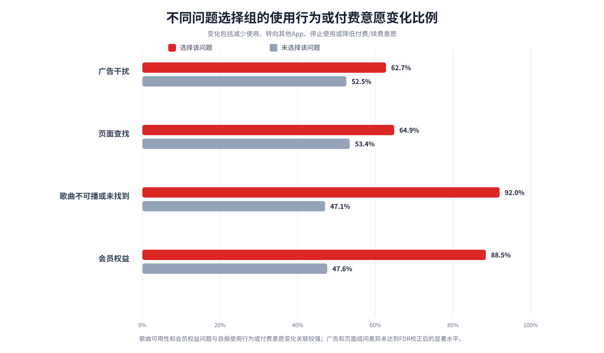

*图9　选择某类问题与未选择该问题的受访者，其使用行为或付费意愿变化比例对比。*

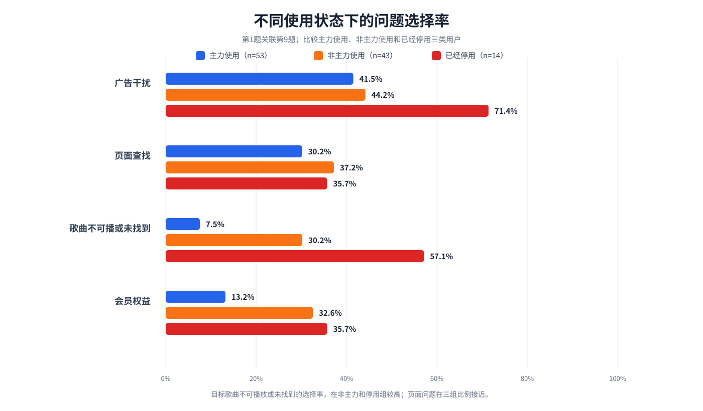

*图10　第1题与第9题的关联。歌曲可用性问题在非主力和停用用户中的选择比例较高，页面问题在三组中的比例接近。*

#### 3.4.4 本次样本的推荐重复反馈集中于主力使用者

64人使用个性化推荐功能，其中24人选择了“推荐歌曲重复或缺乏新鲜感”，占37.5%。这24人全部仍将网易云音乐作为最常用音乐应用。推荐重复问题与较低的自报使用行为或付费意愿变化率同时出现，该关联可能受到使用暴露程度影响：持续使用推荐的用户更有机会感知内容重复。推荐控制的实际效果需通过后续验证确定。

第8题中，推荐符合偏好平均3.84分，推荐新鲜度与多样性为3.30分；公开正向反馈也肯定了日推、私人漫游和小众音乐发现。问卷与公开反馈共同反映了内容重复、新鲜度不足和热门化问题。改进时应保留推荐优势，并增加探索模式、重复控制和负反馈选项。

### 3.5 竞品使用与继续使用意愿（第12—14题）

第12题中，30人在过去3个月只使用网易云音乐，80人还使用过其他音乐应用。较常见的应用包括QQ音乐（32人）、Spotify（25人）和Apple Music（24人）。第13题的80份作答中，较常见的原因是能听到更多想听的歌曲（43人）、播放稳定性或音质体验更好（29人）、与手机或其他常用App衔接方便（26人）。这些结果反映了内容可用性、基础体验和设备衔接需求，可用于确定竞品比较任务。

第14题中，41人确定会继续使用，36人可能会继续使用，合计77人，占70.0%；18人不确定，15人倾向于不再继续使用。意愿结果与第8—11题共同用于理解顾虑，实际留存需通过行为数据验证。

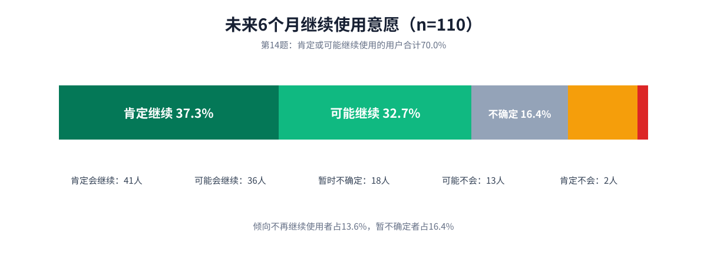

*图11　第14题结果：未来6个月继续使用网易云音乐的意愿。*

### 3.6 优先改进意见与关键词（第15题）

第15题共获得65份实质意见。将回答提取关键词并归类后，出现最多的关键词是歌单与同步（12次），其次是曲库与版权、广告与弹窗（各10次）以及推荐质量（8次）；页面与操作、评论与社区各出现6次。开放题由用户自行表述，因此补充了选择题没有完全展开的细节，例如歌单跨端同步、云盘歌曲管理、评论区治理和会员权益感知。

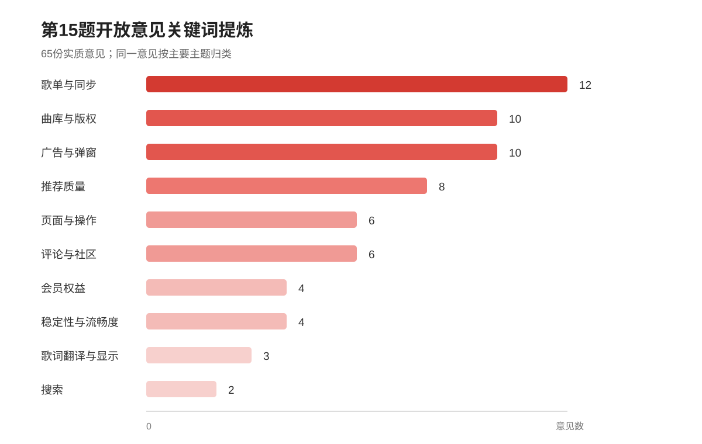

*图12　第15题结果：65份实质意见的关键词提炼。*

## 四、公开反馈与场景核对

### 4.1 正向体验

15条正向反馈主要集中在以下方面：

- **推荐与音乐发现：** 日推、私人漫游和发现页歌单能够帮助用户发现新歌和小众歌曲，部分用户认为推荐准确度优于竞品（P05—P09）。
- **评论与内容生态：** 歌曲评论中的故事、用户自建歌单和电台共同形成了具有辨识度的内容生态（P03、P10、P13）。
- **界面与上手体验：** 部分用户认可整体操作逻辑、界面简洁度和学习成本（P01、P02、P11、P12）。
- **曲库补充与细分内容：** 音乐云盘、小众音乐分类和不同曲风的整理具有使用价值（P04、P14）。
- **情感记录：** 听歌记录、好友记录和年度总结能够形成长期使用记忆（P15）。

### 4.2 负向体验

15条负向反馈涵盖以下问题：

- **歌手与专辑查找：** 反馈涉及完整作品查找、播放范围、专辑内容组织和排序筛选（N01—N04、N07）。现有版本已提供热门歌曲、查看全部歌曲和专辑时间排序，具体需求通过当前路径及作品关系核对确定。
- **曲库与版本质量：** 部分用户反映目标歌曲无法播放，或可用版本不符合预期（N05、N12）。
- **推荐与页面体验：** 反馈涉及首页信息量、内容偏好及热门歌曲占比（N08、N09）。
- **广告与模块控制：** 反馈涉及开屏、返回应用的广告和付费后的非核心模块控制（N11、N13）。
- **功能细节与音质：** 反馈涉及云盘加歌单、关注管理和主观音质体验（N03、N06、N14），具体能力及差异需核对。
- **评论与互动：** 反馈涉及评论质量、一起听中的言语骚扰，以及举报等待（N10、N15）。

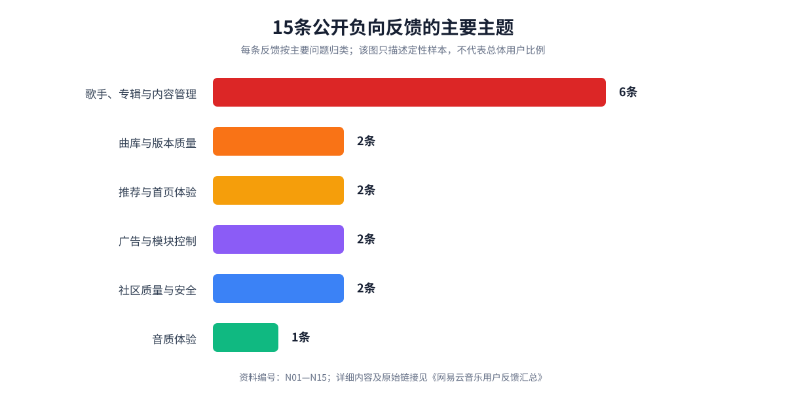

*图13　15条公开负向反馈的主要主题，描述定性样本构成。*

### 4.3 三项任务的现状核对

| 任务 | 已确认能力或记录 | 需要改善的缺口 | 证据范围 |
|---|---|---|---|
| 沿艺人主页查找参与作品 | 网易云已有全部歌曲和专辑时间排序；BOI主页可找到英文版合集 | 已收录的日文多人合集未出现在BOI专辑列表，需要另行搜索 | 对应专辑、艺人列表及发行资料；影响规模通过同类样本核对 |
| 开始听歌、查看信息及返回任务 | 推广卡片出现时音频继续；返回前台、评论区和免费时长场景存在不同触达 | 音乐展示区域占用、跨页面累积打扰及任务恢复成本 | 2026-11-01操作记录；发生频次和账号差异待复测 |
| 举报后查询进度与结果 | 系统通知中可看到已提交；部分公开案件最终得到反馈 | 记录路径中后续状态和结案结果不可见，记录找回和结果覆盖需核对 | 使用反馈与具体公开案例；后台实际处理情况需内部确认 |

BOI案例为2026-10-21发行的日文版《メメントモリ Lament Collection Vol.4》。网易云专辑署名为Various Artists，歌曲署名关联BOI，艺人主页专辑列表未返回该日文版。发行平台在BOI的参加作品中展示日文合集。该案例用于核对已收录作品的关系与路径。[官方公告](https://boi.jp/news/261021o.html)、[发行平台艺人页](https://www.tunecore.co.jp/artists/bankofInnovation)。

推广记录涵盖播放器领时长卡片、返回前台带“点击或扭动手机”提示的全屏广告、评论功能引导、免费时长提示及顶部活动。不同账号首屏分别为心动页和推荐页，心动页保留搜索图标和底部搜索入口；账号差异的原因需核对，任务测试关注入口辨认、识曲发现及页面切换。

举报记录反映受理后状态与结果可见性的需求。评论内容质量、个人偏好、停止接触和疑似违规分别处理；用户的屏蔽选择与平台审核结论各有作用范围。

## 五、问题归类与需求分析

### 5.1 问题主题与需求组

问卷的问题选择、分项评价和开放意见，与公开反馈及场景核对共同形成七类问题。需求按用户任务和改善范围拆分为12组，其中R01包括版本识别R01-A与不可播放后的信息及选择R01-B，共13个分析项。

| 问题类别 | 主要调研发现 | 对应需求组 |
|---|---|---|
| 广告与非核心内容干扰 | 广告问题51人，评分2.50；多场景触达与操作记录 | R02、R03 |
| 页面、歌手与专辑查找效率 | 页面或入口问题37人；作品关系及主页路径核对 | R03、R07、R12 |
| 推荐重复与兴趣偏移 | 64人使用推荐，其中24人选择重复；正负反馈并存 | R04 |
| 曲库、版权与版本 | 25人选择目标内容无法播放或未找到；版本反馈 | R01-A、R01-B、R07 |
| 播放、音质与个人音乐管理 | 72人管理个人音乐；歌单、同步及云盘反馈 | R05、R06、R11 |
| 评论、内容生态与社交安全 | 评论和互动使用背景、内容质量及举报案例 | R09、R10 |
| 会员权益与价值表达 | 26人选择会员问题，不同会员状态的评价存在差异 | R08 |

### 5.2 需求池与本期范围

| 编号 | 用户需求 | 本期判断与处理 |
|---|---|---|
| R01-A | 准确识别目标音乐版本 | 保留需求，版本搜索分组及误播情况另行核对 |
| R01-B | 了解不可播放原因和后续选择 | 保留需求，版权采购、替代版本及恢复提醒不进入本期 |
| R02 | 控制听歌流程中的推广干扰 | 进入推广控制方案，覆盖时机、形式、频次和任务恢复 |
| R03 | 快速找到关键功能并选择常用路径 | 进入推广方案的入口保护与用户显示偏好 |
| R04 | 获得新鲜、合适且可控制的音乐推荐 | 保留推荐需求；偏好与显式反馈机制用于推广控制 |
| R05 | 可靠管理个人音乐并了解跨端状态 | 保留需求，具体同步错误和技术条件需核对 |
| R06 | 批量整理音乐云盘 | 保留需求，先验证批量任务、失败与纠错场景 |
| R07 | 找到艺人明确参与的已收录作品 | 进入作品完整浏览建议，补全关联并复用既有页面 |
| R08 | 理解权益及受限时的可选路径 | 本期处理必要权益说明及重复提示，会员定价另行评估 |
| R09 | 阅读有价值的评论并控制不适内容 | 本期处理举报、屏蔽及偏好分流，评论排序重构保留 |
| R10 | 停止不适接触并查询举报进度和结论 | 进入举报反馈方案，保证完整受理、查询和结案反馈 |
| R11 | 了解音质的实际生效条件 | 保留需求，先核对设备、传输及客观输出 |
| R12 | 管理关注歌手及更新提醒 | 保留需求，验证当前路径、受众规模与提醒负担 |

### 5.3 方案选择依据

需求取舍结合任务后果、证据强度、影响范围和实施依赖。问卷选择率辅助判断关注程度，安全影响和具体任务失败同样进入评估；未知的发生规模、工时和商业损失保留为待验证项。

| 方案 | 选择依据 | 主要依赖 | 定位与优先级 |
|---|---|---|---|
| 歌手作品完整浏览 | 找歌是高频任务，有可复核的作品关联案例，修复范围集中 | 元数据、艺人索引与内容运营 | P1配套建议 |
| 听歌流程推广干扰控制 | 问卷问题选择和低评分相互支持，并有多场景操作记录 | 广告、会员、运营与客户端协作 | P1重点体验方案 |
| 评论及陌生互动举报反馈 | 涉及安全与处理透明度，受理后持续可查及结案反馈属于完整服务要求 | 举报记录、审核、客服与通知 | P0基础保障 |

详细证据、成本风险和分期范围见[需求分析](requirements-analysis.md)。三项方案的内部功能优先级在PRD中单独定义。

## 六、竞品机制比较

### 6.1 比较对象与任务

QQ音乐作为国内直接竞品，Spotify作为音乐服务机制参照；TuneCore Japan用于同一作品的参与关系比较，YouTube用于举报历史机制比较。问卷中QQ音乐、Spotify分别有32人、25人在过去3个月使用过，提供了比较对象的用户背景。

比较围绕已经识别的任务展开，官方资料用于确认机制，客户端中的展示时机、用户操作成本和功能覆盖范围需通过任务实测核对。完整资料与适用边界见[竞品分析报告](competitive-analysis.md)。

### 6.2 作品关系与纠错

Spotify官方合集说明将合集署名与艺人参与作品展示结合；TuneCore的BOI页面展示日文参加作品。Spotify还提供作品错配反馈和使用艺人ID的预防机制。[合集说明](https://support.spotify.com/us/artists/article/compilations/)、[作品错配处理](https://support.spotify.com/us/artists/article/music-mixed-up-with-another-artist/)。

本品可分别维护专辑艺人、歌曲参与者、制作主体与发行公司，并在已确认关系的基础上补齐艺人作品索引。合集保留真实署名，部分参与显示身份和相关曲目；同名与发行公司字段作为待核实线索。

### 6.3 推广与用户控制

| 官方机制 | 可借鉴做法 | 本品需要补足的约束 |
|---|---|---|
| QQ音乐分别提供推荐及广告个性化控制 | 尊重个性化选择，区分音乐偏好和广告设置 | 基础入口、场景保护、频控及关闭规则持续生效 |
| Spotify提供广告类别偏好和单条反馈 | 用明确反馈修正内容匹配 | 类别选择与广告总量分别控制，拒绝记录跨相关页面生效 |
| Spotify Ad Studio提供广告组频控 | 同组不同素材共同占用额度 | 还需控制跨活动、会员促销和自动引导的累计打扰 |
| Spotify特定广告产品提供观看换连续收听 | 清楚表达观看与权益的对应关系 | 用户选择前说明条件、奖励和跳转，结束后恢复原任务 |

来源：[QQ音乐隐私指引](https://privacy.qq.com/document/priview/0b0dc16a0f004a35b77b7fd48a0b125b)、[Spotify广告偏好](https://support.spotify.com/uk/article/managing-your-ad-preferences/)、[广告组频控](https://ads.spotify.com/en-AU/help-center/custom-frequency-cap/)、[Sponsored Session规格](https://ads.spotify.com/en-SG/ad-experiences/sponsored-sessions-specs/)。上述规格分别受广告产品和地区条件约束，广告组规则的范围与全平台推广总量分别核对。

### 6.4 举报记录与状态解释

Spotify的消息控制提供接触管理，内容举报说明列出适用的处理决定申诉路径。YouTube提供视频举报历史，但“仍在线”同时包含待审核和未认定违规；同一视频被多人举报时，部分举报记录可能不显示在个人历史中。[消息帮助](https://support.spotify.com/us/article/messages/)、[内容举报说明](https://www.spotify.com/us/safetyandprivacy/reporting-content/)、[举报历史说明](https://support.google.com/youtube/answer/7687979?hl=en)。

本品的查询设计需要区分内容可用状态与举报处理状态。集中记录应保留每位举报人的受理凭证，排队、实际处理、待补充及结案分别表达；每类结案提供原因类别、时间及适用的后续操作。竞品在特定内容和地区中的能力用于机制比较，具体覆盖继续核验。

## 七、三项方案与PRD

### 7.1 歌手作品完整浏览

**用户目标与依据。** 用户沿艺人主页寻找其参与的作品。问卷提供主动查找的使用背景，BOI案例确认已收录多人合集在艺人路径中的关联缺口。

**方案。** 核对发行来源与参与角色，比较歌曲关系和艺人专辑索引，对明确一致的缺失项补齐关联，有冲突的记录转内容运营复核。复用艺人专辑列表和现有纠错入口，保留Various Artists等真实署名，分别展示独立语言版本，更新索引与缓存并保留变更依据。

**交付与验证。** 对应PRD功能1.1—1.4，使用关联样本与从艺人页查找指定作品的任务验收。关注漏关联、错关联、语言版本和修复后的列表一致性。授权与播放权限遵守现有规则。

### 7.2 听歌流程推广干扰控制

**用户目标与依据。** 用户希望顺利找歌、查看信息、听歌及返回原任务。问卷中的广告低评分、51人问题选择，以及96人的歌曲信息查看，为任务保护提供依据；具体触达环节由操作记录定位。

**方案。** 按当前任务确定展示时机、位置与形式；通过权益、关闭记录和频控校验后，再结合主动行为、兴趣和反馈匹配内容。跨页面共享活动与素材记录，区分关闭、不感兴趣和减少同类推广的作用范围。必要权益提示、会员促销和激励选择分别说明。

一级导航及搜索、识曲、个人音乐入口保持清楚、可发现和可用；首页与可选内容顺序由用户主动选择。内容个性化遵守入口保护与明确设置。播放器推广避开音乐信息和操作区域，返回后接续最新歌曲、队列、位置和播放状态。

**交付与验证。** 对应PRD功能2.1—2.10。基础任务保护、频控、防误触和权益说明先交付，匹配与偏好能力在基础流程可用后实施。按预分配任务次数统计完成率，未找到入口和放弃均纳入；分别观察音频、信息及操作，结合有效转化、每次使用的收益和负反馈判断效果。

### 7.3 评论及陌生互动举报反馈

**用户目标与依据。** 用户需要停止不适接触，并了解举报是否受理、进度、材料要求、结案原因和后续选择。问卷提供评论及互动背景，具体反馈缺口由公开案例与使用记录确认；其发生率尚未通过问卷专门测量。

**方案。** 服务端确认后形成受理记录，失败保留草稿；集中记录、系统通知和详情关联。区分已受理、实际处理中、待补充及已结案，延迟说明覆盖排队和处理中。认定违规、未认定违规、证据不足、范围不适用、重复关联及撤回等结案均给出说明。

用户可先退出或按意愿屏蔽，再决定是否举报。平台处置依据核实的内容、证据和风险，重复举报按标识去重，合并审核保留每位举报人的查询记录；复核形成新结果版本并保留历史。通知失败时仍可从记录查询。

**交付与验证。** 对应PRD功能3.1—3.8，基础交付包含受理至结案的完整处理与反馈。受理按确认提交的去重请求统计，查询按各举报人的已受理记录统计，结案覆盖和查看按受理记录及结果版本统计；后台形成但发布失败的结果计入应发布范围。

## 八、从问卷发现到设计交付

### 8.1 问卷、证据与需求对应

| 题号与发现 | 问卷提供的依据 | 场景与证据核对 | 对应需求 |
|---|---|---|---|
| 第6题：搜索109人 | 主动查找音乐是主要任务 | BOI日文合集、参与署名与主页列表的关联核对 | R07 |
| 第4、8、9、15题：广告51人，评分2.50，开放意见涉及广告 | 用户分层、体验关注与具体意见 | 启动、返回、播放器及评论中的推广记录 | R02、R08相关部分 |
| 第6、8、9题：信息查看96人，页面问题37人，页面评分2.95 | 信息查看与路径效率需要保障 | 不同首页的入口辨认、识曲发现和返回路径 | R03，结合R02 |
| 第6、9、15题：评论和互动使用、内容质量意见 | 社区使用背景和内容控制线索 | 骚扰及举报等待案例、系统通知与后续查询记录 | R09、R10 |

### 8.2 需求、竞品与PRD对应

| 需求与方案 | 竞品参考 | PRD功能 | 主要验收内容 |
|---|---|---|---|
| R07：歌手作品完整浏览 | 合集参与关系、艺人ID和错配反馈 | 1.1—1.4；第6.1、14.1节 | 角色正确、关联完整、版本可辨及指定作品可找到 |
| R02、R03及R08相关部分：听歌流程推广干扰控制 | 个性化选择、类别反馈、广告组频控及激励交换 | 2.1—2.10；第6.2、14.2节 | 任务与入口保护、跨页面反馈、适用权益、匹配及原任务恢复 |
| R09、R10：评论及陌生互动举报反馈 | 接触控制、举报历史、状态含义及适用复核 | 3.1—3.8；第6.3、14.3节 | 受理可查、真实状态、各类结案说明、独立记录和通知失败处理 |

### 8.3 结论与交付

调研结果形成覆盖内容、播放、管理、推荐、推广和互动的需求池。本期围绕作品可发现性、推广与听歌任务的协调、举报处理透明度形成三项方案。推广控制重点改善高频体验；举报反馈优先保障安全相关处理和服务完整性；作品关联通过较集中的关系修复补足浏览路径。

版权采购与替代版本、完整推荐算法、跨端同步、云盘批量管理、音质升级和关注管理继续保留在需求池，按实际任务、合作条件及技术能力安排专项验证。三项设计均需正式版本核对、技术评审和用户任务验证，目标值依据基线确定。

| 材料 | 作用 |
|---|---|
| 问卷原稿（题目见本报告附录A）与分析工作簿（逐行数据仅在本地保留） | 保留题目、答卷及统计依据 |
| 本报告 | 归纳调研发现，明确证据与需求的连接 |
| [需求分析](requirements-analysis.md) | 说明用户任务、成立依据、价值风险与范围 |
| [竞品分析](competitive-analysis.md) | 比较相关机制及适用边界 |
| [产品需求文档](prd.md) | 定义三项方案的功能、交互、规则和验收 |

## 九、研究局限与验证

本次采用便利抽样与转发扩散，年轻学生和男性占比较高；8份硬性质控排除与41份进一步筛选均影响样本构成。结果适用于本次样本，产品总体发生率和商业影响需结合更多样本及日志核对。

问卷存在总体评价先于分项评价、问题与改进题相隔较远等顺序问题；第10题未动态限定第9题已选项，可能影响作答理解。原题及答卷按回收内容保留，具体问题见问卷设计问题记录（限制见本报告第9章）。本次110份记录中第9—10题未发现选择不对应，相关设计局限仍需在后续调查中优化。

30条公开反馈采取正负平衡取样，用于定性理解场景。作品案例、界面记录与竞品官方说明分别覆盖相应时间、版本、账号或地区；可复核案例支持具体问题判断，实际覆盖规模通过复测确定。

用户自述、横截面关联及继续使用意愿用于理解问题，方案成效通过基线、任务测试和适用的对照验证评估。问卷未专门测量作品漏关联和举报进度问题的发生率，两项依据由具体案例及任务核对提供；竞品官方说明与客户端表现分别核验。

## 附录

### 附录A：调查问卷原文

**网易云音乐手机端用户体验调查问卷**

您好！本问卷旨在了解用户对网易云音乐手机App的使用情况、体验评价及产品问题。问卷采用匿名形式，预计需要3—5分钟。请根据最近6个月或最近一次使用网易云音乐的实际体验作答。

**1. 您目前使用网易云音乐手机App的情况是？［单选题］**

- 目前最常使用的音乐App
- 目前仍在使用，但不是最常用的音乐App
- 曾经使用，现在已经不用
- 从未使用过（请跳至问卷末尾，提交答卷）

**2. 您使用网易云音乐多长时间？［单选题］**

- 不满6个月
- 6个月—1年
- 1—3年
- 3—5年
- 5年以上

**3. 您目前使用网易云音乐的频率是？［单选题］**

- 几乎每天
- 每周4—6天
- 每周1—3天
- 每月1—3次
- 很少使用
- 已经停止使用

**4. 您目前的会员状态是？［单选题］**

- 当前拥有会员权益
- 曾经开通过，目前已到期
- 从未开通过
- 不清楚

**5. 您通常在什么场景使用网易云音乐？［多选题］**

- 通勤或出行
- 学习或工作
- 运动
- 放松心情
- 睡前或助眠
- 聚会或与他人分享音乐
- 主动寻找新音乐
- 其他

**6. 您主要使用网易云音乐的哪些功能？［多选题］**

- 搜索歌曲、歌手、专辑或MV等内容
- 使用个性化推荐发现音乐，如每日推荐、私人DJ、漫游、心动模式、相似歌曲
- 浏览排行榜、官方歌单或用户歌单
- 创建、收藏、导入和管理歌单
- 管理个人音乐，如“我喜欢”、最近播放、下载及本地音乐
- 使用听歌识曲
- 查看歌词、翻译、音乐百科等歌曲信息
- 使用黑胶播放器、皮肤、歌词动效等个性化功能
- 查看或发表歌曲评论
- 分享歌曲或使用“一起听”
- 浏览关注的音乐人或其他用户发布的笔记、动态
- 收听播客、有声剧等声音内容
- 其他

**7. 总体而言，您对网易云音乐手机端的满意程度是？［单选题］**

- 非常不满意
- 比较不满意
- 一般
- 比较满意
- 非常满意

**8. 请评价网易云音乐在以下方面的表现。［矩阵单选题］**

评价选项：很差、较差、一般、较好、很好、未使用或不了解。

- 找到并播放想听歌曲的情况
- 搜索歌曲的效率
- 推荐内容符合个人喜好的程度
- 推荐内容的新鲜感与多样性
- 播放加载及运行稳定性
- 音质和音效体验
- 歌词准确度及同步效果
- 歌单、收藏、下载等管理体验
- 页面清晰度与操作便利性
- 广告及弹窗的干扰控制
- 会员价格与权益的匹配程度

**9. 最近使用过程中，您遇到过哪些问题？［多选题］**

- 想听的歌曲无法播放或未能找到
- 搜索结果不符合需要
- 推荐内容不符合个人喜好
- 推荐歌曲重复或缺乏新鲜感
- 加载慢、播放中断、卡顿或闪退
- 音质、音效或歌词体验不理想
- 歌单、收藏、下载或同步操作不方便
- 页面信息较多或功能入口难找
- 广告、弹窗或活动提示影响使用
- 会员价格、权益或付费规则不符合预期
- 歌曲评论内容质量不理想
- 客服或问题反馈处理不理想
- 其他
- 没有遇到明显问题（选择任一选项请跳至第11题）

**10. 上述问题中，对您使用体验影响最大的是哪一个？（若上一题只选一个本题可不填）［单选题］**

- 想听的歌曲无法播放或未能找到
- 搜索结果不符合需要
- 推荐内容不符合个人喜好
- 推荐歌曲重复或缺乏新鲜感
- 加载慢、播放中断、卡顿或闪退
- 音质、音效或歌词体验不理想
- 歌单、收藏、下载或同步操作不方便
- 页面信息较多或功能入口难找
- 广告、弹窗或活动提示影响使用
- 会员价格、权益或付费规则不符合预期
- 歌曲评论内容质量不理想
- 客服或问题反馈处理不理想
- 其他

**11. 该问题对您的使用产生了什么影响？［单选题］**

- 基本没有影响
- 减少了使用频率
- 更多使用其他音乐App
- 降低了付费或续费意愿
- 已经停止使用
- 其他

**12. 除网易云音乐外，过去3个月您还使用过哪些在线音乐App？［多选题］**

- QQ音乐
- 酷狗音乐
- 酷我音乐
- 汽水音乐
- 咪咕音乐
- 波点音乐
- Apple Music
- Spotify
- 其他
- 只使用网易云音乐（选择任一选项请跳至第14题）

**13. 您使用其他音乐App的主要原因是什么？［多选题］**

- 能听到更多想听的歌曲
- 推荐内容更符合个人喜好
- 搜索和播放更加方便
- 播放稳定性或音质体验更好
- 页面更加简洁清晰
- 广告及弹窗干扰更少
- 会员价格或免费体验更合适
- 与手机或其他常用App衔接方便
- 其他

**14. 未来6个月，您继续使用网易云音乐的意愿是？［单选题］**

- 肯定不会继续使用
- 可能不会继续使用
- 暂时不确定
- 可能会继续使用
- 肯定会继续使用

**15. 如果只能优先改进一项，您最希望网易云音乐改进什么？［填空题］**

**16. 您的年龄段是？［单选题］**

- 17岁及以下
- 18—22岁
- 23—30岁
- 31—40岁
- 41—50岁
- 51岁及以上

**17. 您目前的职业或身份是？［单选题］**

- 中学生
- 大专或本科在校生
- 研究生
- 企业或公司职员
- 机关或事业单位工作人员
- 个体经营者或自由职业者
- 待业或暂无固定职业
- 退休人员
- 其他

**18. 您的性别是？［单选题］**

- 男
- 女
- 其他
- 不便透露

**19. 您使用的手机系统是？［单选题］**

- iOS
- Android
- HarmonyOS
- 其他
- 不清楚

### 附录B：公开用户反馈摘录

以下条目为公开评论的压缩转述，具体内容以来源链接中的原始记录为准。

#### 正向反馈

- **P01：** 整体操作比较顺手，比Spotify更容易理解。来源：[LINUX DO](https://linux.do/t/topic/2582948?tl=en)
- **P02：** 关闭非必要页面后界面较清爽，交互和简洁度优于QQ音乐。来源：[LINUX DO](https://linux.do/t/topic/2582948?tl=en)
- **P03：** 歌曲评论区里的故事很有趣，能增强听歌体验。来源：[LINUX DO](https://linux.do/t/topic/2582948?tl=en)
- **P04：** 音乐云盘可以补充平台资源，资源使用范围较丰富。来源：[LINUX DO](https://linux.do/t/topic/2582948?tl=en)
- **P05：** 推荐新歌的效果比酷狗好，适合用来发现歌曲。来源：[LINUX DO](https://linux.do/t/topic/2582948?tl=en)
- **P06：** 日推、私人漫游和发现页歌单推荐具有较高使用价值。来源：[LINUX DO](https://linux.do/t/topic/2582948?tl=en)
- **P07：** 听歌推荐比较准确，能贴合个人口味。来源：[乐游网用户留言](https://m.962.net/y/258219)
- **P08：** 推荐中经常能发现小众歌曲。来源：[乐游网用户留言](https://m.962.net/y/258219)
- **P09：** 每日推荐具有明显的平台特色。来源：[乐游网用户留言](https://m.962.net/y/258219)
- **P10：** 评论区氛围优于其他音乐软件。来源：[乐游网用户留言](https://m.962.net/y/258219)
- **P11：** 界面简洁，新用户也容易上手。来源：[乐游网用户留言](https://m.962.net/y/258219)
- **P12：** 设计简约但不单调，整体体验舒适。来源：[App Store评论](https://apps.apple.com/cn/app/%E7%BD%91%E6%98%93%E4%BA%91%E9%9F%B3%E4%B9%90-%E6%95%B0%E4%BA%BF%E9%9F%B3%E4%B9%90%E7%95%85%E5%90%AC/id590338362?l=en-GB&see-all=reviews&platform=iphone)
- **P13：** 电台、用户自建歌单和评论共同形成了有特色的内容生态。来源：[App Store评论](https://apps.apple.com/cn/app/%E7%BD%91%E6%98%93%E4%BA%91%E9%9F%B3%E4%B9%90-%E6%95%B0%E4%BA%BF%E9%9F%B3%E4%B9%90%E7%95%85%E5%90%AC/id590338362?l=en-GB&see-all=reviews&platform=iphone)
- **P14：** 小众音乐类型较丰富，对不同曲风的分类整理也很细致。来源：[App Store评论](https://apps.apple.com/cn/app/%E7%BD%91%E6%98%93%E4%BA%91%E9%9F%B3%E4%B9%90-%E6%95%B0%E4%BA%BF%E9%9F%B3%E4%B9%90%E7%95%85%E5%90%AC/id590338362?l=en-GB&see-all=reviews&platform=iphone)
- **P15：** 听歌记录、好友记录和年度总结兼具实用性与情感价值。来源：[AppFollow收录评论](https://apps.appfollow.io/ios/wang-yi-yun-yin-le-1-8yi-nei-rong-chang-ting/590338362?country=cn)

#### 负向反馈

- **N01：** 歌手页面无法直接播放该歌手的全部歌曲，入口位置也较深。来源：[LINUX DO](https://linux.do/t/topic/2582948?tl=en)
- **N02：** “播放全部”只能处理最新50首，无法一键保存完整歌曲列表。来源：[LINUX DO](https://linux.do/t/topic/2582948?tl=en)
- **N03：** 关注歌手后缺少有效的关注管理界面。来源：[LINUX DO](https://linux.do/t/topic/2582948?tl=en)
- **N04：** 歌手专辑页混入单曲、节目和改编版本，旧专辑难以查找。来源：[LINUX DO](https://linux.do/t/topic/2582948?tl=en)
- **N05：** 歌曲版权和曲库不足，许多想听的歌曲无法播放。来源：[LINUX DO](https://linux.do/t/topic/2582948?tl=en)
- **N06：** 将云盘歌曲加入歌单的操作不方便。来源：[LINUX DO](https://linux.do/t/topic/2582948?tl=en)
- **N07：** 专辑缺少筛选和排序功能，经典作品不容易找到。来源：[LINUX DO](https://linux.do/t/topic/2582948?tl=en)
- **N08：** 新版页面越来越杂乱，首页推荐与个人口味偏差较大。来源：[乐游网用户留言](https://m.962.net/y/258219)
- **N09：** 日推中出现过多热门短视频歌曲，个性化程度下降。来源：[乐游网用户留言](https://m.962.net/y/258219)
- **N10：** 评论区质量下降，原有的社区氛围有所减弱。来源：[乐游网用户留言](https://m.962.net/y/258219)
- **N11：** 广告数量较多，开屏和返回App时的广告干扰听歌。来源：[App Store评论](https://apps.apple.com/cn/app/%E7%BD%91%E6%98%93%E4%BA%91%E9%9F%B3%E4%B9%90-%E6%95%B0%E4%BA%BF%E9%9F%B3%E4%B9%90%E7%95%85%E5%90%AC/id590338362?l=en-GB&see-all=reviews&platform=iphone)、[乐游网用户留言](https://m.962.net/y/258219)
- **N12：** 部分歌曲只有不理想的版本，翻唱资源较多且质量参差。来源：[App Store评论](https://apps.apple.com/cn/app/%E7%BD%91%E6%98%93%E4%BA%91%E9%9F%B3%E4%B9%90-%E6%95%B0%E4%BA%BF%E9%9F%B3%E4%B9%90%E7%95%85%E5%90%AC/id590338362?l=en-GB&see-all=reviews&platform=iphone)
- **N13：** 购买SVIP后仍不能自由隐藏演出票、云村等非核心模块。来源：[App Store评论](https://apps.apple.com/cn/app/%E7%BD%91%E6%98%93%E4%BA%91%E9%9F%B3%E4%B9%90-%E6%95%B0%E4%BA%BF%E9%9F%B3%E4%B9%90%E7%95%85%E5%90%AC/id590338362?l=en-GB&see-all=reviews&platform=iphone)
- **N14：** 用户认为最高档音质仍弱于部分竞品的普通高音质。来源：[App Store评论](https://apps.apple.com/cn/app/%E7%BD%91%E6%98%93%E4%BA%91%E9%9F%B3%E4%B9%90-%E6%95%B0%E4%BA%BF%E9%9F%B3%E4%B9%90%E7%95%85%E5%90%AC/id590338362?l=en-GB&see-all=reviews&platform=iphone)
- **N15：** “一起听”存在言语骚扰风险，用户举报后迟迟未获得处理结果。来源：[App Store评论](https://apps.apple.com/cn/app/%E7%BD%91%E6%98%93%E4%BA%91%E9%9F%B3%E4%B9%90-%E6%95%B0%E4%BA%BF%E9%9F%B3%E4%B9%90%E7%95%85%E5%90%AC/id590338362?l=en-GB&see-all=reviews&platform=iphone)

